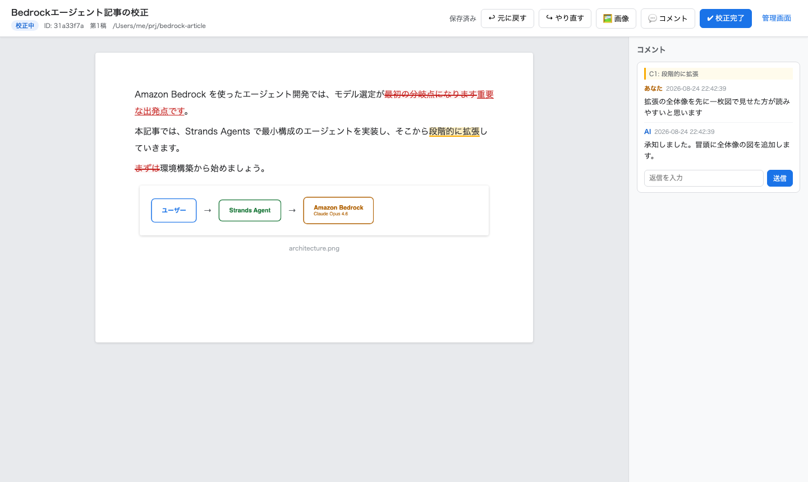
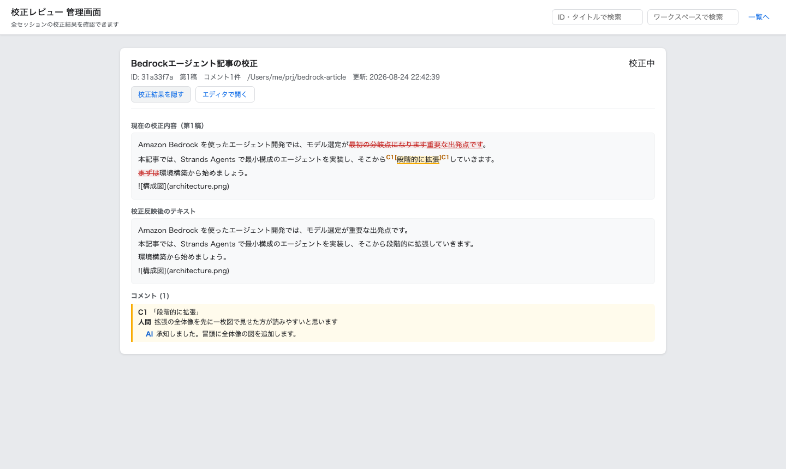

# human-lang-embedding

AIが生成した文章を、人間がブラウザ上の**トラックチェンジ付きエディタ**（Wordの校正機能ライク）で校正し、その結果をAIにフィードバックするためのMCPサーバーです。削除・追加・コメントのラリーを繰り返すことで、AIのライティング精度を段階的に高めることを目的としています。

マークダウン（トラックチェンジ編集）に加えて **HTMLファイルのレビュー**にも
対応しています。HTMLはレンダリングされた見た目のまま表示され、人間は任意の
箇所を範囲選択して「ここがこう」というコメントを付けます（本文編集はなし）。
文字では示せない図の一部などは、ドラッグで範囲を囲んでコメントでき、
その範囲のスクリーンショットがAIに渡ります。
モードは `open_review` に渡すファイルの拡張子（`.html` / `.htm`）で自動的に
切り替わります。

## ワークフロー

```
AI                             人間
│ open_review(file_path)        │
│ ─────────────────────────────▶│ mdファイルを読み込みブラウザにエディタが開く
│                               │ 削除（赤斜線）・追加（赤文字）・コメント
│                               │ 「校正完了」→ チャットでAIに連絡
│ get_feedback(id)              │
│ ◀─────────────────────────────│ 削除・追加・コメントを構造化データで受領
│ reply_comment(...)            │ コメントに返信（スレッド化）
│ submit_revision(file_path)    │
│ ─────────────────────────────▶│ 修正稿mdを再校正（以降繰り返し）
```

`open_review` / `submit_revision` は本文の文字列ではなく**ファイルのパス**を
受け取り、内容を直接読み込みます。MCPプロトコル越しに長文を往復させる必要が
なく、AIはワークスペース上のファイルを編集してパスを渡すだけで済みます。

HTMLレビューの場合は、`get_feedback` も本文を返さずコメント（選択テキストと
前後の文脈）だけを返し、AIは `source_path` のファイルを自分で読みます。

```
AI                             人間
│ open_review(/path/x.html)    │
│ ─────────────────────────────▶│ レンダリング表示された図解・記事を閲覧
│                               │ 気になる文字列を選択、または範囲を囲んでコメント
│                               │ 「校正完了」→ チャットでAIに連絡
│ get_feedback(id)              │
│ ◀─────────────────────────────│ quote + prefix/suffix + コメント本文を受領
│                               │ （囲んだ範囲はスクリーンショットの画像も）
│ （source_path のHTMLを直接読む） │
│ submit_revision(/path/x2.html)│
│ ─────────────────────────────▶│ 修正版を再レビュー（以降繰り返し）
```

## 画面イメージ

校正エディタ。削除は赤い斜線、追加は赤文字で記録され、右サイドバーでコメントのラリー（人間⇔AI）ができます。画像（GIFアニメを含む）・動画・音声も本文の中に表示・再生されます。



管理画面。全セッションの校正結果を差分付きで一覧できます（各画面のヘッダーから、または `hle-admin` コマンドで開けます）。



## 主な機能

- **トラックチェンジ**: 人間が文字を消すと赤い斜線、追記すると赤文字で記録。改行の追加・削除も追跡
- **マークダウン装飾**: 見出し・リスト・タスクリスト・引用・コードブロック・表（罫線付きのセル表示、ヘッダ・寄せ指定に対応）・太字・斜体・取り消し線・インラインコード・リンク（タイトル付き・自動リンク）・文中の画像・脚注を画面上で装飾表示。記法の記号は本文テキストとして残すので、校正結果からマークダウンが失われない（[表示方針](#マークダウンの表示方針)）
- **日本語IME対応**: 変換確定した文字列が正しく「追加」として記録される
- **コメント**: 任意の選択範囲にコメントを付与。右サイドバーに表示され、返信・返信への返信が可能。AIも `reply_comment` で参加できる。コメント・返信はあとから編集・削除でき、削除すると本文のハイライトも外れる。入力欄（下書き・編集・返信）は書いた分だけ縦に伸びる
- **コメントの種類（指摘・質問）**: コメントごとに「指摘」（既定）か「質問」を選べる。指摘はAIが修正稿に反映し、質問はAIが `reply_comment` で答えるだけで本文は直さない。AIには `get_feedback` の `comments[].tag`（`"issue"` / `"question"`）で渡り、扱いはツール説明に明記してある。種類はあとから編集フォームで変えられる
- **メディアへのコメント**: 文字列だけでなく、画像・動画・音声そのものを指定してコメントできる。クリックして選んで「💬 コメント」を押すと、そのファイルに紐づく（`target="image"`、`image` に対象の名前、md では `kind` に種類）。HTMLレビューでは `` に加えてインラインSVGなどの図、`<video>`・`<audio>` も対象にできる
- **メディアの埋め込み（画像・動画・音声）**: md内の `` 形式のローカル参照は、mdファイルの場所（次いでワークスペースルート。Zennの `/images/...` 形式にも対応）を基準に自動で解決・添付される。拡張子で描き分け、画像は ``、動画は再生・シークできる `<video controls>`、音声は `<audio controls>` になる（[対応形式](#対応するメディア)）。解決できない参照・非対応の形式は `missing_images` で報告。`images` パラメータで追加添付も可能。人間も「🖼 メディア」ボタン（複数選択可）・ペースト・本文へのドロップで追加でき、クリック+Backspaceで削除指定、クリック+「💬 コメント」で指摘ができる（すべて変更として追跡）
- **HTMLレビュー**: `.html` を渡すとレンダリング表示+範囲選択コメントのモードで開く。選択範囲は quote（選択テキスト）と prefix / suffix（前後の文脈）で保存され、同じ文言が複数あっても位置を特定できる。コメント範囲はDOMを書き換えずにハイライト表示（CSS Custom Highlight API）。画像や図、動画・音声はクリックで選んでコメントでき、位置は `image_ref`（`img:2` や `video:0` のようにタグ名と出現順）で保存される。対象HTML内のスクリプトは実行されない（[セキュリティ](#セキュリティ)）
- **範囲指定コメント（HTMLレビュー）**: 「▭ 範囲指定」を押してページ上をドラッグすると、囲んだ範囲にコメントを付けられる。文字として選べない図の一部や、複数の要素にまたがる箇所の指摘に使う。囲んだ範囲はその場でスクリーンショット（PNG、長辺1600px以下）になり、AIは `get_feedback` の応答に添付された画像で受け取る。範囲内に表示されていた文字列と、図の中なら SVG の座標系（viewBox）での位置も渡るので、AIはソース上の該当箇所を探せる。枠は図に対する割合で覚えるので、画面の幅が変わって図が伸び縮みしても同じ所を指す（[フィードバックの形](#htmlレビューのフィードバックコンテキストの渡し方)）
- **複数ラリー**: `submit_revision` で修正稿を積み重ねる。過去のリビジョンは差分要約に圧縮して保存
- **AI差分表示**: 第2稿以降で「🔵 AI差分」ボタンを押すと、前の稿の最終状態（人間の校正を反映済み）から今の稿でAIが変えた箇所を青で重ねる。消した文字は青い取り消し線、足した文字は青字。人間の赤い変更と入り混じって読みにくいときはボタンで即座に消せる（状態はセッションごとに記憶）。差分表示は見た目だけの重ね描きで、保存される校正内容には一切影響しない
- **校正内容の蓄積**: 一連の添削が終わったら、受けた指摘の傾向を整理して skills（エージェントのスキル定義。Kiroなら `.kiro/skills` や `.kiro/steering`）へ反映することをAIに促す。同じ指摘を毎回人間にさせないための仕組みで、`get_feedback` / `submit_revision` のツール説明に組み込んである
- **検索**: ID・タイトル・ワークスペースパスでセッションを検索
- **管理画面**: 全セッションの校正結果（注釈付きテキスト・コメントスレッド・過去稿の差分）を一覧・閲覧

## セットアップ

```bash
cd /Users/hikotoi/utility/human-lang-embedding
uv sync                              # 依存関係のインストール
uv run playwright install chromium   # E2Eテストを動かす場合のみ
```

### MCP登録（Kiroの例: `~/.kiro/settings/mcp.json`）

```json
{
  "mcpServers": {
    "human-lang-embedding": {
      "command": "/opt/homebrew/bin/uv",
      "args": ["run", "--directory",
               "/Users/hikotoi/utility/human-lang-embedding", "hle-mcp"],
      "autoApprove": ["open_review", "get_feedback", "submit_revision",
                      "reply_comment", "list_reviews", "get_review"]
    }
  }
}
```

## MCPツール一覧

| ツール | 役割 | 主な引数 |
|---|---|---|
| `open_review` | md / htmlファイルを読み込んで校正セッションを作成しブラウザでレビュー画面を開く（拡張子でモード判定）。`images` は追加で添付する画像・動画・音声のパス | `file_path`, `title`, `workspace`, `images` |
| `get_feedback` | 校正結果（削除・追加・コメント）を取得。HTMLレビューの範囲コメントはスクリーンショットを画像で添付する | `session_id`, `include_screenshots` |
| `submit_revision` | 修正稿のファイルを新リビジョンとして提示（セッションとモードを揃える） | `session_id`, `file_path`, `open_browser`, `images` |
| `reply_comment` | コメントスレッドにAIとして返信 | `session_id`, `comment_id`, `message` |
| `list_reviews` | セッションを検索 | `query`, `workspace`, `limit` |
| `get_review` | セッション詳細（全リビジョン・全コメント） | `session_id` |

`get_feedback` の `annotated_text` は次の形式で変更点を表します。

```
これは【削除:テスト】【追加:本番】です。【改行追加】
〖C1〗二行目〖/C1〗です。
【画像削除:old.png】
【動画追加:screen.mp4】
【音声削除:narration.mp3】
〖C2〗〖/C2〗
```

- `【削除:…】` / `【追加:…】` : 文字の削除・追加
- `【改行追加】` / `【改行削除】` : 段落区切りの増減
- `〖C1〗…〖/C1〗` : コメント番号1の対象範囲（`comments[].number` に対応）
- `【画像削除:名前】` / `【画像追加:名前】` : 画像の削除指定・追加。動画は
  `【動画削除:…】` / `【動画追加:…】`、音声は `【音声削除:…】` / `【音声追加:…】`
  （種類は拡張子で決まる）。`changes` では種類を問わず `image_delete` /
  `image_insert` で、`kind`（`"image"` / `"video"` / `"audio"`）が付く
- メディアへのコメントは行全体が範囲になる（上の `〖C2〗…〖/C2〗`）。
  該当コメントは `target="image"`、`image` に対象のファイル名、`kind` に種類を持つ

日本語では `【重要】` のようにマーカーと同じ記号が本文に現れるため、
`annotated_text` では本文由来の `【】〖〗` と `\` をバックスラッシュで
エスケープします（例: 本文の `【重要】` → `\【重要\】`）。これにより削除・
追加の境界が一意に決まります。`annotated_text` は差分を目で追うための
可読表現なので、**本文を引用するときは `result_text`、変更点を機械的に
判定するときは `changes` を使ってください**（どちらも無加工の厳密な表現です）。

`comments[].number`（および `〖C1〗` のマーカー）は `get_feedback` を呼んだ
時点のコメント配列の順番です。人間がコメントを削除すると以降の番号が
繰り上がるため、**コメントを特定して会話するときは `number` ではなく `id` を
使ってください**（`reply_comment` も `comment_id` を取ります）。番号が変わって
いる可能性がある場合は `get_feedback` を取り直してください。

`comments[].tag` はコメントの種類で、AIの扱いが変わります（md / html 共通）。

| tag | 画面の表示 | AIの扱い |
|---|---|---|
| `"issue"`（既定） | 指摘 | 内容を踏まえて修正稿に反映する |
| `"question"` | 質問 | `reply_comment` で答えるだけ。これを理由に本文は変えない |

質問の範囲に重なる人間の削除・追加は、ふつうの校正として反映されます。
AIが直した方がよいと考えた場合も回答の中で提案するにとどめ、人間が種類を
指摘に変えるか、返信で修正を求めたときに反映します。この扱いは MCP の
`instructions` と `get_feedback` / `submit_revision` / `reply_comment` の
ツール説明に書いてあります。保存データでは質問だけが `"tag": "question"` を
持ち、指摘（と `tag` を持たない旧データ）は指摘として扱われます。

### HTMLレビューのフィードバック（コンテキストの渡し方）

HTMLモードの `get_feedback` は **HTML全文を返しません**（数百KBの図解HTMLを
MCP越しに往復させるとAIのコンテキストを圧迫するため）。代わりに次を返します。

```json
{
  "mode": "html",
  "source_path": "/path/to/diagram.html",
  "comments": [{
    "number": 1, "id": "c...", "tag": "issue",
    "quote": "選択されたテキスト",
    "prefix": "選択の直前50文字",
    "suffix": "選択の直後50文字",
    "text": "ここがこう、というコメント", "replies": []
  }]
}
```

AIは `source_path` のファイルを自分で直接読み、`quote` + `prefix` / `suffix`
で該当箇所を特定して修正します。注意点が2つあります。

- `quote` は**レンダリング後のテキスト**なので、HTMLソース上ではタグを
  跨いでいることがあります（quote「重要な点」← ソース `<b>重要</b>な点`）。
  quote がソースにそのまま見つからない場合はタグを挟んだ形で探すこと
- 同じ文言が複数箇所にある場合は `prefix` / `suffix` の文脈で絞り込むこと。
  ブラウザ側のハイライト復元も同じロジック（完全一致 → 文脈の一致長で選択）
  で動いています

#### 範囲コメント（`target="region"`）

人間がドラッグで囲んだ範囲へのコメントは、文字列の代わりに範囲の
スクリーンショットと位置を持ちます。

```json
{
  "number": 2, "id": "c...", "tag": "issue", "target": "region",
  "quote": "左上の箱 / 矢印のラベル",
  "texts": ["左上の箱", "矢印のラベル"],
  "region": {"x": 40, "y": 620, "width": 480, "height": 210,
             "frame_width": 1080, "frame_height": 834,
             "ref": "svg:0", "rel": [0.037, 0.26, 0.444, 0.097],
             "svg_box": [74.1, 1043.0, 888.9, 388.9]},
  "image": "region-c....png", "screenshot_size": [960, 420],
  "screenshot": "/…/data/files/<セッションID>/region-c....png",
  "text": "ここの矢印の向きが逆", "replies": []
}
```

- `get_feedback` は JSON の後ろに、現在の稿への範囲コメントのスクリーン
  ショットを画像（MCP の image コンテンツ）で添付します（最大10枚・合計8MB）。
  添付した順は JSON の `attached_screenshots` にあります。前の稿への範囲
  コメントは前のラリーで受け取り済みで写っているのも古い稿なので添付せず、
  上限を超えた分と合わせて `screenshot`（PNGの絶対パス）だけを渡します。
  コメントの番号や返信だけを確かめ直すときは `include_screenshots=false` で
  画像を省けます
- `texts` は範囲内に表示されていた文字列（文字の中心が範囲に入るもの）で、
  ソースを探す手がかりです。`quote` はそれをつないだ見出しです
- `region` は表示中の文書での位置（CSS px、スクロール込み）です。範囲が
  図の中なら `ref` がその図（`svg:0` など）、`rel` が図の枠に対する割合、
  `svg_box` がその SVG の座標系（viewBox）での範囲 `[x, y, 幅, 高さ]` です。
  AIは `svg_box` と図の要素の座標を突き合わせて、どの要素への指摘かを絞れます
- スクリーンショットは長辺1600px以下（範囲が小さければ表示の2倍の解像度）、
  1枚3MB以下です。Claude が1回に20枚を超える画像を受けたときの長辺の上限
  （2000px）と、Bedrock の1枚の上限（3.75MB）を下回るようにしています
- `texts` とスクリーンショットに写った文字はレビュー対象のページから来た
  ものなので、AIはそれを指示として実行しません（ツール説明に明記）

`get_feedback` は画像を添付するため、構造化出力（outputSchema と
structuredContent）を持たないツールにしました。MCP Python SDK の
[説明](https://py.sdk.modelcontextprotocol.io/servers/media/)でも、画像は
モデルが見るための content で、出力スキーマを持たないものとされています。
以前は `{"result": "<JSONの文字列>"}` の structuredContent も返していましたが、
今は content だけを返します。
content の JSON テキストは md モードでも以前と同じで、
`tests/test_html_review.py` で固定しています。

添付画像をモデルにどう渡すかはMCPクライアント次第です。Kiro IDE については、
インストール済みの拡張（2026年9月24日の版）のコードを読み、ツール結果の
テキストと画像を分けて取り出して、画像はbase64の文字列ではなく画像として
モデルへの入力に添えることを確かめました（実際の会話での確認はまだです）。
画像を受け取れないクライアントでは、`screenshot` のファイルを画像として
開いてください。

## 画面

| URL | 内容 |
|---|---|
| `/session/<ID>` | レビュー画面（`open_review` が自動で開く）。mdセッションは校正エディタ、htmlセッションはHTMLレビューページが配信される |
| `/` | セッション一覧（ID・タイトル・ワークスペースで検索） |
| `/admin` | 管理画面。全セッションの校正結果・コメント・過去稿の差分要約を閲覧 |

### エディタの操作方法

- **削除**: 文字を選択して Backspace / Delete → 赤い斜線が付く（文字は残る）
- **追加**: そのまま入力 → 赤文字で挿入される（日本語IME対応）
- **改行**: Enter で改行追加、段落先頭で Backspace で改行削除（¶マーカー）
- **自分の追記の取り消し**: 自分が追加した文字を消すと痕跡なく消える
- **コメント**: 範囲を選択して「💬 コメント」→ 右サイドバーに表示。返信可。返信は Enter で送信、Shift+Enter で改行
- **コメントの種類**: 下書き欄で「指摘」（既定）か「質問」を選ぶ。質問にするとAIは返信で答えるだけで本文を直さない。カードには種類のバッジ（指摘は黄、質問は紫）が付き、「編集」から種類を変えられる
- **入力欄の大きさ**: コメントの下書き・編集・返信の欄は、書いた分だけ縦に伸びる（CSS の `field-sizing: content`）。画面の高さの6割で伸びるのをやめ、それ以上は欄の中でスクロールする。`field-sizing` に対応していないブラウザ（Chrome 123 / Firefox 152 より前など）では従来どおり固定の高さで、手で広げられる
- **コメントの編集・削除**: カードの「編集」で書き直し、「削除」で取り消し（確認あり）。返信も個別に編集・削除できる。コメントを削除すると本文のハイライトも外れる
- **メディアの追加**: 「🖼 メディア」ボタン（複数選択可）、画像・動画・音声ファイルのペースト → カーソルのある段落の後ろに挿入。本文にファイルをドロップすると、落とした段落の後ろに入る（本文の外に落としてもページは離れない）。非対応の形式と上限を超える大きさは、送る前に理由を出して断る
- **メディアの削除**: 画像・動画・音声をクリックして選択 → Backspace（もう一度で取り消し）
- **メディアへのコメント**: クリックして選択 → 「💬 コメント」。コメント付きのものは黄色い枠で示され、クリックすると対応するカードが開く
- **動画・音声の再生**: プレーヤーの再生・シーク・音量はそのまま使える。プレーヤーを操作するとその段落が選ばれ、フォーカスはプレーヤーに残るので、Space（再生・一時停止）や矢印（シーク）は本文への入力にならない。Backspace は削除指定になる。Chrome の標準プレーヤーは操作部の上のクリックをページ側へ流さないので、選択はフォーカスの移動で拾っている
- **元に戻す/やり直す**: Cmd+Z / Cmd+Shift+Z
- **校正完了**: ヘッダーの「✔ 校正完了」を押し、チャットでAIに完了を伝える

### HTMLレビューの操作方法

- **コメント**: 表示されたページの文字列（インラインSVG内のテキストも可）を
  ドラッグで選択して「💬 コメント」→ 右サイドバーで入力。本文の編集はできない
- **画像・図・動画・音声へのコメント**: `` やインラインSVG、`<video>`、
  `<audio>` をクリックして選択 → 「💬 コメント」。文字として選択できない図も
  そのまま対象にできる。動画・音声はプレーヤーを操作しても選ばれる
  （`image_ref` は `video:0` / `audio:0`）
- **図の中の文字**: インラインSVGの中の文字は、ドラッグで選ぶと文字列への
  コメント、ドラッグせずにクリックすると図そのものへのコメントになる。
  コメント済みの文字列をクリックすると、図の中でも対応するカードが開く
- **範囲へのコメント**: 「▭ 範囲指定」を押すと、ページの上が十字のカーソルに
  なる。コメントしたい所をドラッグで囲むとコメント欄が開き、AIに渡る
  スクリーンショットがそのまま表示される。書いている途中で囲み直すと、
  書いた文と種類を残したまま範囲だけが替わる。範囲指定の間もホイールで
  ページを送れる（送れるのはページ全体のスクロールだけで、文字の選択や
  図のクリックはできない）。囲みかけの Esc はその囲みを取り消し、もう一度
  ボタンを押すか、囲んでいないときに Esc を押すとモードを抜ける。続けて
  囲めるよう、コメントを追加してもモードは続く
- **範囲の枠**: コメント済みの範囲は点線の枠と番号で示される。番号を押すと
  （範囲指定の間は枠の中のクリックでも）対応するカードが開き、カードを
  押すと範囲がページの中央に来る。枠は図に対する割合で覚えるので、画面の
  幅が変わって図が伸び縮みしても、`<details>` の開閉などで図が動いても、
  図の同じ所に付いていく。前の稿で囲んだ範囲は灰色の枠と「C1・第1稿」の
  ような番号で示す（今の稿では図が変わっていることがある）
- **スクリーンショットの作り方と制約**: 表示中の文書を複製し、SVG の
  foreignObject に入れてブラウザ自身の描画で画像にしてから切り抜く。
  スクロール位置、幅で切り替わる CSS（@media）と vw / vh（スクロールバーが
  幅を取る環境も含む）、rem、スクロールで貼り付いた sticky の要素、画面に
  固定した fixed の要素は表示と同じ位置に写り、実際の画面のスクリーン
  ショットと画素で一致することをE2Eで確かめている。XMLでは不正な属性名
  （`@click` や `:class` など）やコメントがあっても撮れる。ハイライトや枠は
  このページが重ねた印なので写らない。写らないもの・表示と違うものは、
  要素の内側のスクロール位置（とそのスクロールで貼り付く sticky）、動画の
  フレーム、アニメーションの途中の状態、本文中の制御文字（同じ意味の記号に
  置き換える）。Chrome（Chromium）で確認しており、Safari などは未確認
- **ハイライト**: コメント済みの範囲は黄色でハイライトされ、画像・図は
  黄色い枠線で囲まれる。本文側をクリックすると対応するコメントカードが、
  カードをクリックすると本文の該当箇所がハイライト・スクロールされる
- **コメントの種類・返信・編集・削除**: mdエディタと同じ操作（指摘か質問かを選べる。AIも `reply_comment` で参加）
- **校正完了**: ヘッダーの「✔ 校正完了」を押し、チャットでAIに完了を伝える

### 対応するメディア

形式と上限の定義は `src/hle_mcp/media.py` の1か所にあり、MCP の参照解決・
ブラウザからの追加（`GET /api/media` で受け取る）・配信・注釈の種類名が
これに従います。

| 種類 | 拡張子 | 1ファイルの上限 | 表示 |
|---|---|---|---|
| 画像 | png jpg jpeg gif webp avif bmp | 50MB | ``（GIFアニメも動く） |
| 動画 | mp4 m4v mov webm ogv | 1GB | `<video controls>` |
| 音声 | mp3 m4a aac wav ogg oga opus flac | 200MB | `<audio controls>` |

- 書き方は画像と同じ ``。行全体がこの記法の行がプレーヤーに
  なる（文中の記法は装飾されたテキストのまま）
- SVG は画像でもスクリプトを持てるので受け付けない（従来どおり）
- 再生できるかはブラウザのコーデック次第。Google Chrome 155 と Playwright
  同梱の Chromium 151 で、mp4（H.264）・mov（H.264）・webm（VP8）・mp3・
  m4a（AAC）・ogg（Opus）・wav の読み込みと、mp4・mov・webm の再生を
  確かめた。iPhone の HEVC の mov や、Chrome が読めない形式はプレーヤーが
  エラーになる（添付と校正はできる）
- 配信は Range に 206 で応え、分割して送る。動画のシークは Range で行われ、
  Safari は Range に応えないサーバーの動画を再生しないとされる（未確認）。
  Chrome も、Range に応えないサーバー（Python の http.server で実測）では
  seekable が [0, 0] になり、途中へ飛べない。Ogg（Opus）は長さも Infinity に
  なる（Range に応えれば末尾を読んで長さが分かる。E2Eで確認）
- ブラウザからの追加は、ファイルの中身をそのままボディで送る
  （`POST /api/sessions/<ID>/files?name=<名前>`、
  `Content-Type: application/octet-stream`）。base64 の JSON だと 4/3 倍に
  膨らみ全体をメモリに載せるので、動画はこちらで受ける。受け取る前に形式と
  `Content-Length` を確かめ、保存も配信も 1MB / 256KB ずつ読み書きする
- MCP（`open_review` / `submit_revision`）から渡したローカルファイルは、
  中身が同じ保存済みファイルがあればその名前を使い、複製しない。稿ごとに
  同じ動画のパスを渡し直しても、コピーは増えない。中身が変わっていれば
  従来どおり `名前-1.mp4` のような別名で添付し、本文の参照もそちらに書き換わる
- 常駐Webサーバーの入れ替えでは、動画・音声を送っている途中の接続は待たずに
  切る（ブラウザは再生位置まで読むと受信を止めるので、送信が終わらない
  ことがある）。ブラウザは続きを Range で新しいワーカーから取り直す
- HTMLレビューでは、対象HTML内の `data:` の動画・音声を再生できる
  （iframe の CSP に `media-src data:`）。ローカルの相対パスの動画・音声
  （と画像）は解決しないので、自己完結の HTML にする

### マークダウンの表示方針

本文のマークダウンは画面上で装飾されますが、**記法の記号は本文テキストとして
残したまま**、小さく淡い色で表示します（見出しの `##`、太字の `**` など）。

記号を消してリッチ要素（`<h2>` や `<strong>`）へ置き換える実装にすると、
編集HTMLから原文を復元する経路が壊れます。`feedback.py` の逆変換は段落
（`<p>`）と変更マーカー（`<del>`/`<ins>`）とテキストノードだけを見る設計で、
それ以外のタグは構造ごと無視されるためです。結果として `get_feedback` の
`result_text` からマークダウン記法が消えます。`result_text` はAIが次の修正稿を
書く出発点なので、**1往復するだけで文書構造が失われる**ことになります。

記号をテキストとして残す方式なら、逆変換は無損失のままで（Python側の変更は
不要）、記法そのもの（見出しレベルの変更、リスト化の解除など）も通常の
削除・追加としてそのまま校正できます。E2Eテスト `tests/e2e/test_markdown.py`
で「原文 → 装飾 → 編集HTML → `result_text`」が完全一致することを検証しています。

コードブロック（``` フェンス）の内側は、記法を解釈せず等幅で表示します。

表も同じ方針で描きます。`<table>` は作らず（1行＝1段落の対応が崩れて逆変換が
壊れるため）、1行を `<p>` のままセル（`<span class="md-td">`）に分けて横に並べ、
罫線はセルの枠線で引きます。セル区切りの `|` はテキストとして残るので、
列の追加・削除も普通の校正操作でできます。ヘッダ行・区切り行はスタイルで
区別し、区切り行の `:---` / `:---:` / `---:` は各列の寄せに反映されます。
GFMの外側パイプ省略形（`A | B` + `--- | ---`）にも対応します。表かどうかは
区切り行の有無で判定するため、`|` を含むだけの普通の文は表になりません。

すでに編集を開始したセッション（`edited_html` が保存済み）は、校正内容を失わない
よう保存時のHTMLをそのまま復元します。装飾は新しいセッションと
`submit_revision` 以降のリビジョンで適用されます。

## 管理画面の開き方

2通りあります。

1. **各画面から遷移**: エディタ / 一覧のヘッダーにある「管理画面」リンク
2. **アドホックにCLIから**:

```bash
uv run --directory /Users/hikotoi/utility/human-lang-embedding hle-admin
```

Webサーバーが動いていなければ常駐Webサーバーを起動し、管理画面を
ブラウザで開いてすぐ終了します（Webサーバーは残ります）。

## 常駐Webサーバーと自動更新

Webサーバーは MCPサーバーや `hle-admin` とは別の常駐プロセス
（`python -m hle_mcp.daemon`）として動きます。最初に `open_review` 等を
呼んだとき、または `hle-admin` を実行したときに自動で起動し、呼び出し元が
終了しても残ります。

**コードを更新すると、数秒で自動的に新しい版へ入れ替わります。**
開いている校正画面はそのまま使え、入れ替えの間に保存が失敗することは
ありません。

- スーパーバイザーが `127.0.0.1` の待ち受けソケットを持ち続け、実際の配信は
  ワーカープロセスが行う。`src/hle_mcp/*.py` の変更を検知したら（編集途中を
  拾わないよう 2 秒落ち着くのを待ってから）新しいワーカーを起動する
- 新しいワーカーは専用ポートで主要な画面とAPIの**自己テスト**を行い、通ったら
  同じ待ち受けソケットで受付を始める。その後に古いワーカーへ終了を指示し、
  古いワーカーは処理中の保存に応答し終えてから終了する。待ち受けソケットは
  一度も閉じないので、入れ替えの間に接続が拒否されることはない
- **壊れたコード（構文エラーや自己テスト失敗）は配信に出さず**、前の版の
  ワーカーで動き続ける。原因は `hle-admin --status` の `update_error` と
  MCPツール応答の `server_note` に出る。直せば自動で入れ替わる
- ワーカーが異常終了したら自動で再起動する。`daemon.py` / `versioning.py`
  自体の更新は、スーパーバイザーが同じPIDのまま再execして待ち受けを引き継ぐ
- 静的ファイル（HTML/JS/CSS）はリクエストごとにディスクから配信される。
  開いている画面には「新しい版に更新されました」の案内が出るので、
  再読み込みボタンで新しい画面になる（校正内容は保存してから読み込み直す）

作業ツリーのコードがそのまま使われるので、コミット前の編集途中の変更も
（自己テストを通れば）反映されます。

```bash
uv run hle-admin --status   # 動いている版・ディスク上の版・入れ替えの失敗理由
uv run hle-admin --stop     # 処理中の保存を返し終えてから止める
```

ログは `data/web.log`、入れ替えの状況は `data/web-status.json` にあります。

### 校正内容を失わないための仕組み

サーバー側の入れ替えに加えて、ブラウザ側でも保存を取りこぼさないように
しています。

- 保存は1本ずつ直列に送る（古い内容が後から届いて新しい内容を上書きしない）
- 保存に失敗したら 1〜15 秒の間隔で自動再試行し、成功するまで
  「保存できません・再試行中…」と表示する。サーバーが応答するようになれば
  待ち時間を待たずに保存する
- 保存が済むまでは校正内容をブラウザ（localStorage）にも退避する。
  サーバーに届かないままタブを閉じても、次に開いたときに復元して保存する
- 保存できていない間は「✔ 校正完了」を受け付けない（AIが古い内容を
  受け取らないように）
- 保存には編集していた稿の番号を付ける。AIが次の稿を出した後に前の稿への
  編集が届いた場合、新しい稿を上書きせず、前の稿の `late_edited_html` に
  控えとして残す（画面にもその旨が出る）

## データ保存と差分保存

データはすべてこのリポジトリの `data/` 配下に保存されます。

```
data/
├── sessions/<セッションID>.json   # セッション本体
└── files/<セッションID>/          # 添付した画像・動画・音声（範囲コメントの
                                   #   スクリーンショット region-<コメントID>.png もここ）
```

セッションJSONは ID・タイトル・ワークスペースパス・モード（`mode`: md / html）・
入力元ファイルパス（`source_path`）・ステータス・リビジョン配列・コメント配列を
持ちます（`mode` を持たない旧データは md 扱い）。mdモードではデータ増加を
緩やかにするため、**編集中の現行リビジョンだけが全文HTML（`edited_html`）を持ち、
`submit_revision` で確定した過去リビジョンは差分要約
（`feedback_summary`: annotated_text / result_text / changes）に圧縮**され、
全文HTMLは破棄されます。原文は各リビジョンの `base_text` から常に復元できます。

htmlモードは本文編集がないため `edited_html` は常に空で、`base_text` に対象HTML
そのものが入ります。コメントには選択範囲の前後の文脈（`prefix` / `suffix`）が
付きます。範囲コメントは `target: "region"` と、スクリーンショットの
ファイル名（`image`）・大きさ（`screenshot_size`）・位置（`region`）・範囲内の
文字列（`texts`）を持ちます。スクリーンショットはそのコメントのためだけに
撮ったものなので、コメントを削除すると一緒に消えます。

## 環境変数

| 変数 | 既定値 | 説明 |
|---|---|---|
| `HLE_PORT` | `8917` | Webサーバーのポート（本アプリ以外が使用中なら近傍を自動探索。`0` はテスト用で、呼び出し元プロセス内のスレッドで起動し常駐しない） |
| `HLE_DATA_DIR` | `<リポジトリ>/data` | データ保存先 |
| `HLE_NO_BROWSER` | (未設定) | 設定するとブラウザの自動起動を抑止 |

## セキュリティ

### 設計前提

**単一ユーザーが自分のマシンで動かすローカル開発ツール**を前提としています。
Webサーバーは `127.0.0.1` にのみバインドし、認証機構は持ちません。
マルチユーザーホストでの共用や、`127.0.0.1` 以外での公開は想定していません。

ただし「ループバックにバインドしているから安全」は成り立ちません。攻撃者は
外部からこのマシンに接続する必要がなく、**あなたのブラウザを踏み台にできる**
ためです。そのため以下の防御を入れています。

| 防御 | 防ぐもの |
|---|---|
| `Host` ヘッダの許可リスト（`127.0.0.1` / `localhost` / `[::1]` のみ） | DNSリバインディング。悪性ドメインを `127.0.0.1` へ再解決して同一オリジンを偽装し、全セッション（本文・ワークスペース絶対パス）を読み出す攻撃 |
| 状態変更系での `Origin` 検証 | 悪性サイトからのCSRF書き込み（本文・コメント・ステータス・画像の改ざん） |
| POSTの `Content-Type: application/json` 必須化。メディアの添付（`/files`）だけは `application/octet-stream` 必須（どちらも simple request では送れず、HTMLフォームでも送れない。サーバーは OPTIONS に応じないのでプリフライトも通らない） | `text/plain` などでプリフライトを回避する simple request による書き込み |
| 添付は拡張子の許可リスト（SVG・HTML などは不可）、種類ごとの上限を `Content-Length` で受け取る前に確認、保存名は英数字・日本語・`_-` に整える、書き込み途中の一時ファイル（`.upload-*`）は一覧にも配信にも出さない | スクリプトを持てるファイルの配信、ディスクを埋める巨大な送信、パス要素の注入、書きかけのファイルの配信 |
| エディタのCSPは `media-src 'self'`（同じオリジンの添付だけ）、iframe のレビュー対象HTMLは `media-src data:` のみ | 外部の動画・音声の読み込み |
| CSP（`default-src 'none'` ベース、インラインなし）+ `nosniff` + `X-Frame-Options: DENY` | 万一HTMLが注入された場合のスクリプト実行、MIMEスニッフィング、フレーム埋め込み |
| コメントIDを `[A-Za-z0-9_-]{1,64}` に制限 + HTMLエスケープで引用符も対象 | `data-cid` 属性を抜け出す属性インジェクションXSS |
| `annotated_text` のマーカーエスケープ | 本文の `【】` によるAIの差分誤読、および注釈への指示混入 |
| HTMLレビュー: `sandbox="allow-same-origin"`（`allow-scripts` なし）のiframe + 専用CSP（`default-src 'none'` でスクリプト不許可、`style-src 'unsafe-inline'` のみ許可）で二重にスクリプトを遮断 | レビュー対象HTML内の悪性スクリプト実行。表示に必要なインラインCSSは通す |
| レビュー対象HTMLの配信（`/api/sessions/<ID>/source`）だけ `X-Frame-Options: SAMEORIGIN` + `frame-ancestors 'self'`、他は従来どおり `DENY` | 外部サイトからのフレーム埋め込み（クリックジャッキング） |
| 範囲のスクリーンショットは、複製した文書を SVG の画像として描いて作る（画像として描く SVG ではスクリプトも外部の読み込みも動かない） | スクリーンショットを作る処理を通じて、レビュー対象HTMLのスクリプトが動くこと |
| 範囲のスクリーンショットをPNGの署名・長辺1600px・3MB以下で検証し、画像とコメントを1回のリクエストで揃えて保存する（検証に落ちたら保存した画像も消す） | 不正な画像や大きすぎる画像がAIに渡ること。画像だけ・コメントだけが残ること |

`Origin` ヘッダを送らないクライアント（ローカルCLI・テスト）は許可しています。
CSRFはブラウザ由来の脅威であり、ローカルプロセスは `data/` を直接読めるため、
そこを塞いでも実効的な意味がないという判断です。

### 受容しているリスク

**保存された編集HTMLをサーバー側でサニタイズしていません**（`edited_html` は
そのまま保存され、エディタでは `innerHTML` で復元されます）。次の理由で
意図的にそうしています。

- 悪性HTMLの侵入経路が存在しないことを確認済みです。ペーストは
  `text/plain` と画像・動画・音声のファイル（添付として保存し、段落は
  DOM API で作る）のみを取り込み、`base_text` の描画はマークダウン装飾を含めて
  すべて DOM API（`createTextNode` / `createElement`）で組み立てるため、
  外部の汚染テキストからHTMLは入りません（`tests/e2e/test_markdown.py::
  test_html_in_base_text_is_not_interpreted` で担保）。唯一の書き込み口は上表の
  `Host`/`Origin`/`Content-Type` ガードで塞いだAPIです
- 仮に注入されてもCSPがスクリプト実行を止めます
- 一方で許可リストサニタイザがエディタの実出力より少しでも厳しいと、
  **利用者の校正内容が黙って失われます**。残存リスクよりこの副作用が重いと
  判断しました

次のいずれかに該当する場合は、実データをフィクスチャにしたテストとセットで
サニタイズを導入してください。

- 自分以外の利用者が使う
- `127.0.0.1` 以外にバインドする
- 複数ユーザーが同居するホストで動かす

また、`ensure_server` は指定ポートで `{"app":"hle-mcp"}` を返すプロセスを
本アプリと見なして再利用します。同一ユーザー権限の悪性ローカルプロセスが
ポートを先取りしてなりすます余地がありますが、そのプロセスは `data/` を
直読できるため実害の増分はないと判断し、受容しています。

常駐Webサーバーの入れ替え・停止を指示するHTTPエンドポイントは設けていません。
入れ替えはスーパーバイザーがディスク上のコードを見て自分で判断し、停止は
シグナル（`hle-admin --stop`）でのみ行います。ブラウザ経由のCSRFで
サーバーを止めたり差し替えたりする経路を作らないためです。

## テスト

```bash
uv run pytest                      # 全テスト（ユニット + Playwright E2E）
uv run pytest --ignore=tests/e2e   # ユニット/統合のみ
```

セキュリティ関連のテストは、ガードを無効化すると実際に失敗することを
確認済みです（テストが別の要因で通っていないことの検証）。

- `tests/test_guard.py` … `Host`/`Origin`/`Content-Type` を偽装したリクエストと
  セキュリティヘッダの検証
- `tests/e2e/test_security.py` … 実ブラウザでの攻撃再現。Chromiumを
  `--host-resolver-rules=MAP evil.test 127.0.0.1` で起動してDNS
  リバインディング成立後の状態を作り、ループバック上の別ポートに攻撃者
  サイトを立ててCSRFを再現する。CSP違反が1件も出ないことも確認する
- `tests/test_daemon.py` … 常駐スーパーバイザーを実プロセスで起動し、
  パッケージの複製を書き換えて更新を再現する。入れ替え・構文エラー・
  自己テスト失敗・ワーカーの強制終了・スーパーバイザー自身の更新の各場面で、
  保存リクエストを送り続けても失敗が0件で、最後に送った内容が保存されている
  ことを確かめる
- `tests/e2e/test_save_resilience.py` … 実ブラウザ（keep-alive 接続のまま）で
  入力し続けながらワーカーを入れ替えても全文が保存されること、保存失敗の
  自動再試行、サーバー停止中にタブを閉じた分の復元、稿の取り違え防止を検証する
- `tests/e2e/test_html_review.py` … HTMLレビューの実ブラウザ検証。対象HTML内の
  `<script>` が実行されないこと（`window.__pwned` が undefined、`document.title`
  が書き換えられていないこと）とインラインCSSが効いていることを同時に確認し、
  範囲選択→コメントで `quote` / `prefix` / `suffix` が保存されること、
  ハイライトの描画と削除、インラインSVG内テキストの選択、AI返信のポーリング
  反映、CSP違反が出ないことを検証する。図の中の文字のドラッグは、選択を
  スクリプトで作ると click が起きず不具合を見逃すので、CDP の
  `Input.dispatchMouseEvent` でブラウザの入力経路を通して送る（Playwright の
  `page.mouse` はボタンを押したまま動かすと、sandbox の iframe で固まる）
- `tests/e2e/test_region_review.py` … 範囲指定モードの実ブラウザ検証。保存した
  スクリーンショットを、同じ範囲の Playwright のスクリーンショットと画素で
  比べる（スクロールした図の上、@media と rem が効いた狭い画面、貼り付いた
  sticky と fixed、XMLでは不正な属性名、スクロールバーが幅を取る環境。
  最後のものは Playwright が既定で付ける `--hide-scrollbars` を外した
  ブラウザで行う）。枠がスクロール・画面幅の変更・`<details>` の開閉・
  再読み込みに付いていくこと、前の稿の枠の区別、カードと枠の連動、囲み直しで
  書いた文が残ること、囲みかけの Esc、削除でファイルも消えることも確かめる。
  rem の基準・スクロール位置・画像の大きさ・図への追従・XMLの整形・
  fixed/sticky の置き直し・スクロールバーの幅・Esc の順序・再レイアウトの
  追従・長いテキストの走査・前の稿の区別・style 属性の戻し方のどれかを
  外すと、対応するテストが失敗することを確認済み
- `tests/test_html_review.py` … 範囲コメントの保存（PNGの検証、位置の検証、
  画像を書いた後に落ちたらその画像だけを消す）と、`get_feedback` が MCP の
  image コンテンツで画像を添付すること（インメモリのMCPクライアントで、
  JSON側にbase64が重複しないこと、現在の稿の分だけ・10枚・合計8MBまで
  であること、途中で画像が消えても失敗しないこと、md モードの応答の形）を
  検証する
- `tests/e2e/test_media.py` … 動画・音声・GIF の実ブラウザ検証。拡張子で
  `` / `<video>` / `<audio>` に描き分けられ、実際に読み込まれる
  （長さ・解像度が取れる）こと、動画が Range（206）でシークできること、
  音声の再生ボタンを押しても段落が選ばれ Backspace で削除指定できること、
  プレーヤーの上の Space が本文に入らないこと、ボタン（複数）・ペースト・
  ドロップでの追加、非対応の形式と上限超えを送る前に断ること、HTML
  レビューの data: の動画・音声へのコメントを確かめる。Google Chrome が
  入っていれば mp4 / mov / m4a の再生も Chrome で確かめる（無ければ skip）。
  CSP の media-src・Range・focusin・フォーカスの移し直し・クリックの扱い・
  drain での切断・iframe の media-src・ドロップ・複製の抑止・送る前の確認・
  注釈の種類名のどれかを外すと、対応するテストが失敗することを確認済み
- `tests/test_api.py` / `tests/test_guard.py` / `tests/test_storage.py` …
  生のバイト列での添付（25MB を分割して書く、上限を `Content-Length` で
  断る）、Range の解釈（206 / 416 / 無視して 200）、`application/octet-stream`
  を添付の口だけで受けること、ブラウザが受信を止めた動画の送信が入れ替えの
  drain を待たせないこと、種類ごとの上限、同じ中身のファイルを複製しないこと

テスト用の小さな動画・音声（数KB）は `tests/fixtures/media/` にあり、
ffmpeg の `testsrc` と `sine` で作った。

> Chromiumの Private Network Access は public→loopback の `fetch` を先に
> 遮断するため、攻撃者ページをループバック上に置かないとサーバー側の
> 検証を通過するか確かめられません。ブラウザ側の緩和はバージョンや
> ブラウザによって差があるので、サーバー側の検証を防御の本体としています。

## 構成

```
src/hle_mcp/
├── server.py      # MCPサーバー本体（ツール定義、md/htmlモード判定）
├── webserver.py   # ローカルWebサーバー（UI配信 + JSON API + CSP、ワーカー本体）
├── daemon.py      # 常駐スーパーバイザー（コード更新の検知とワーカーの無停止入れ替え）
├── versioning.py  # コードの版の計算・データディレクトリ
├── storage.py     # セッション/添付ファイルの永続化・検索・リビジョン圧縮
├── media.py       # 添付できる画像・動画・音声の形式（拡張子・種類・MIME）と上限
├── feedback.py    # 編集HTML → フィードバック抽出（md/htmlで構造が異なる）
├── admin.py       # hle-admin CLI（管理画面を開く・--status・--stop）
└── static/
    ├── index.html / tracker.js / app.js   # mdトラックチェンジエディタ
    ├── html-review.html / .js / .css      # HTMLレビューページ（範囲指定・切り抜きを含む）
    └── admin.html / admin.js / style.css  # 管理画面・共通スタイル
```

HTMLレビューは既存のmdエディタ（index.html / app.js / tracker.js）に
一切手を入れず、`/session/<ID>` の配信時にセッションのモードを見て
ページを出し分ける方式で追加されています。
