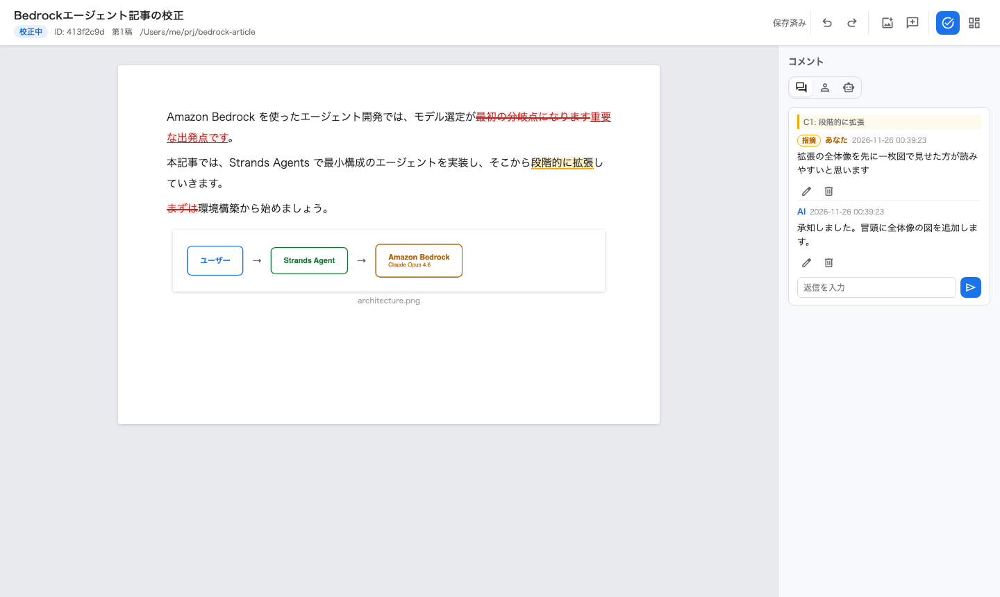
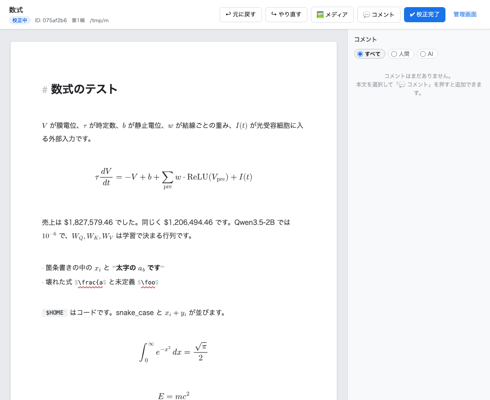

# human-lang-embedding

AIが生成した文章を、人間がブラウザ上の**トラックチェンジ付きエディタ**（Wordの校正機能ライク）で校正し、その結果をAIにフィードバックするためのMCPサーバーです。削除・追加・コメントのラリーを繰り返すことで、AIのライティング精度を段階的に高めることを目的としています。

マークダウン（トラックチェンジ編集）に加えて **HTMLファイルのレビュー**にも
対応しています。HTMLはレンダリングされた見た目のまま表示され、人間は任意の
箇所を範囲選択して「ここがこう」というコメントを付けます（本文編集はなし）。
文字では示せない図の一部などは、ドラッグで範囲を囲んでコメントでき、
その範囲のスクリーンショットがAIに渡ります。
モードは `open_review` に渡すファイルの拡張子（`.html` / `.htm`）で自動的に
切り替わります。

## ワークフロー

```
AI                             人間
│ open_review(file_path)        │
│ ─────────────────────────────▶│ mdファイルを読み込みブラウザにエディタが開く
│                               │ 削除（赤斜線）・追加（赤文字）・コメント
│                               │ 「校正完了」→ チャットでAIに連絡
│ get_feedback(id)              │
│ ◀─────────────────────────────│ 削除・追加・コメントを構造化データで受領
│ reply_comment(...)            │ コメントに返信（スレッド化）
│ add_comment(id, quote, ...)   │
│ ─────────────────────────────▶│ 人間の書き足しなどを指してAIからコメント
│                               │ （画面を開くと本文の該当箇所に結び付く）
│ submit_revision(file_path)    │
│ ─────────────────────────────▶│ 修正稿mdを再校正（以降繰り返し）
```

`open_review` / `submit_revision` は本文の文字列ではなく**ファイルのパス**を
受け取り、内容を直接読み込みます。MCPプロトコル越しに長文を往復させる必要が
なく、AIはワークスペース上のファイルを編集してパスを渡すだけで済みます。

HTMLレビューの場合は、`get_feedback` も本文を返さずコメント（選択テキストと
前後の文脈）だけを返し、AIは `source_path` のファイルを自分で読みます。

```
AI                             人間
│ open_review(/path/x.html)    │
│ ─────────────────────────────▶│ レンダリング表示された図解・記事を閲覧
│                               │ 気になる文字列を選択、または範囲を囲んでコメント
│                               │ 「校正完了」→ チャットでAIに連絡
│ get_feedback(id)              │
│ ◀─────────────────────────────│ quote + prefix/suffix + コメント本文を受領
│                               │ （囲んだ範囲はスクリーンショットの画像も）
│ （source_path のHTMLを直接読む） │
│ submit_revision(/path/x2.html)│
│ ─────────────────────────────▶│ 修正版を再レビュー（以降繰り返し）
```

## 画面イメージ

校正エディタ。削除は赤い斜線、追加は赤文字で記録され、右サイドバーでコメントのラリー（人間⇔AI）ができます。画像（GIFアニメを含む）・動画・音声も本文の中に表示・再生されます。



管理画面。全セッションの校正結果を差分付きで一覧できます（各画面のヘッダーから、または `hle-admin` コマンドで開けます）。


言語が `mermaid` のコードブロックは、ソース（校正の対象）の直後に描画した図が出ます。図は読み取り専用で、保存されません。


TeX の数式（文中の `$...$`、ブロックの `$$ ... $$` と ` ```math `）は描画されます。どちらも TeX は隠れて式だけが見え、式は1つの塊として選べます。TeX を直すときだけ、ダブルクリックで TeX を出します。描けない式は TeX のまま示します。



## 主な機能

- **トラックチェンジ**: 人間が文字を消すと赤い斜線、追記すると赤文字で記録。改行の追加・削除も追跡
- **マークダウン装飾**: 見出し・リスト・タスクリスト・引用・コードブロック・表（罫線付きのセル表示、ヘッダ・寄せ指定に対応）・太字・斜体・取り消し線・インラインコード・リンク（タイトル付き・自動リンク）・文中の画像・脚注を画面上で装飾表示。記法の記号は本文テキストとして残すので、校正結果からマークダウンが失われない（[表示方針](#マークダウンの表示方針)）
- **Mermaid 図の描画**: 言語が `mermaid` のコードブロック（` ```mermaid ` 〜 ` ``` `、`~~~` も可）があると、そのブロックの直後に図を描いて表示する。図は読み取り専用の表示で、本文ではない（保存せず、`result_text` やコメントの quote に混ざらない）。ソースのテキストは今までどおり本文に残り、削除・追加・コメントはソースに対して行う。人間がソースを編集すると、止まって 0.4 秒後に「今の結果」（削除を除き追加を含む文字列）で描き直す。構文エラーのときは図の代わりにエラーの文言を出す（[Mermaid 図の描画](#mermaid-図の描画)）
- **数式の描画**: 文中の `$...$` と、ブロックの `$$ ... $$`・` ```math ` を MathJax で描き、TeX を隠して式だけを見せる。TeX は本文に残り（削除・追加・コメントは TeX に対して行う）、描いた式は保存せず、`result_text` やコメントの quote に混ざらない。式は1つの塊で、クリックで式全体を選び（コメント・置き換えの対象）、Backspace で式全体を削除にする（式のまま赤の取り消し線）。TeX を出すのは、ダブルクリックで編集するときと、式の一部に変更がある式・描けない式だけ。数式に対応する前に保存したセッションも、開くと式を描く。金額（`$100 と $200`）は式にならず、TeX の `_` や `*` を斜体・太字にしない。MathJax は隔離フレームの中だけで動く（[数式の描画](#数式の描画)）
- **コードブロックの構文ハイライト**: 言語つきのコードフェンス（` ```python ` や Zenn 形式の ` ```ts:app.ts `）の中の文字に色を付ける。色は CSS Custom Highlight API で重ねるだけで本文の DOM は変えないので、保存される HTML・`result_text`・コメントの quote には影響せず、保存済みのセッションにも効く。人間が追加した文字（赤字）には色を付けない。言語の指定が無いブロックには付けない（[コードブロックの構文ハイライト](#コードブロックの構文ハイライト)）
- **日本語IME対応**: 変換確定した文字列が正しく「追加」として記録される
- **コメント**: 任意の選択範囲にコメントを付与。右サイドバーに表示され、返信・返信への返信が可能。AIも `reply_comment` で参加できる。コメント・返信はあとから編集・削除でき、削除すると本文のハイライトも外れる。入力欄（下書き・編集・返信）は書いた分だけ縦に伸びる
- **AIからのコメント（`add_comment`）**: 人間が書き足した部分の意図が読み取れない・誤りに見えるが黙って直すべきでないとき、AIはチャットではなくその箇所に `add_comment` でコメントを残せる（`author="ai"`。カードには文字の「AI」バッジが付く）。指示をどう適用した／しなかったかをその箇所で説明するのにも使える。人間はカードで返信でき、AIは `get_feedback` の `comments[].replies` でその返信を受け取る。AIが付けた直後はまだ本文に結び付いておらず（`anchored: false`・番号なし・quoteのみ）、人間がレビュー画面を開くと quote を本文から探して人間コメントと同じ経路（`span.cmt`）で結び付き、以降は番号・黄ハイライト・カード↔本文リンクが付く。見つからない quote はカードに「本文に該当箇所が見つかりません」と出て、返信・削除はできる（画面を開くたびに探し直す）。人間と同じく返信・削除でき、管理画面にもAIバッジが出る
- **コメントの絞り込み（著者別）**: 右サイドバーの上部に「すべて / 人間 / AI」の絞り込みがあり、トップレベルコメントの著者でスレッド丸ごと（返信を含む）表示を切り替える。既定は「すべて」で、画面を開くたびに「すべて」へ戻る。隠したコメントは本文のハイライト（mdの黄マーカー、HTMLレビューのハイライト・画像の枠・範囲の枠）も消え、「すべて」に戻すと元どおりになる。ネイティブのラジオなのでキーボード（矢印キー）でも操作でき、ポーリングによる再描画や新着コメントでは選択が戻らない
- **コメントの種類（指摘・質問）**: コメントごとに「指摘」（既定）か「質問」を選べる。指摘はAIが修正稿に反映し、質問はAIが `reply_comment` で答えるだけで本文は直さない。AIには `get_feedback` の `comments[].tag`（`"issue"` / `"question"`）で渡り、扱いはツール説明に明記してある。種類はあとから編集フォームで変えられる
- **メディアへのコメント**: 文字列だけでなく、画像・動画・音声そのものを指定してコメントできる。クリックして選んでコメントのボタン（`add_comment`）を押すと、そのファイルに紐づく（`target="image"`、`image` に対象の名前、md では `kind` に種類）。HTMLレビューでは `` に加えてインラインSVGなどの図、`<video>`・`<audio>` も対象にできる
- **メディアの埋め込み（画像・動画・音声）**: md内の `` 形式のローカル参照は、mdファイルの場所（次いでワークスペースルート。Zennの `/images/...` 形式にも対応）を基準に自動で解決・添付される。拡張子で描き分け、画像は ``、動画は再生・シークできる `<video controls>`、音声は `<audio controls>` になる（[対応形式](#対応するメディア)）。解決できない参照・非対応の形式は `missing_images` で報告。`images` パラメータで追加添付も可能。人間もメディアを追加のボタン（`add_photo_alternate`）（複数選択可）・ペースト・本文へのドロップで追加でき、クリック+Backspaceで削除指定、クリック+コメントのボタン（`add_comment`）で指摘ができる（すべて変更として追跡）
- **HTMLレビュー**: `.html` を渡すとレンダリング表示+範囲選択コメントのモードで開く。選択範囲は quote（選択テキスト）と prefix / suffix（前後の文脈）で保存され、同じ文言が複数あっても位置を特定できる。コメント範囲はDOMを書き換えずにハイライト表示（CSS Custom Highlight API）。画像や図、動画・音声はクリックで選んでコメントでき、位置は `image_ref`（`img:2` や `video:0` のようにタグ名と出現順）で保存される。対象HTML内のスクリプトは実行されない（[セキュリティ](#セキュリティ)）
- **範囲指定コメント（HTMLレビュー）**: 範囲指定のボタン（`screenshot_region`）を押してページ上をドラッグすると、囲んだ範囲にコメントを付けられる。文字として選べない図の一部や、複数の要素にまたがる箇所の指摘に使う。囲んだ範囲はその場でスクリーンショット（PNG、長辺1600px以下）になり、AIは `get_feedback` の応答に添付された画像で受け取る。範囲内に表示されていた文字列と、図の中なら SVG の座標系（viewBox）での位置も渡るので、AIはソース上の該当箇所を探せる。枠は図に対する割合で覚えるので、画面の幅が変わって図が伸び縮みしても同じ所を指す（[フィードバックの形](#htmlレビューのフィードバックコンテキストの渡し方)）
- **複数ラリー**: `submit_revision` で修正稿を積み重ねる。過去のリビジョンは差分要約に圧縮して保存
- **コメントの場所へ1クリックで飛ぶ（稿が変わっても）**: コメントカードを押すと本文の該当箇所へ飛ぶ。AIが次の稿を出して本文が書き換わっても、コメントを付けた当時の場所（変更する前にあった所）へ飛べる。前の稿の最終テキストから今の本文までを差分でたどって場所を割り出すので、引用文が書き換わっていても、書き換わった文に着く（同じ文が複数あっても、付けた方に着く）。書き換わっているときは飛んだ直後にトーストで知らせる。差分から場所が割り出せない（全面的に書き換わった）ときだけ、従来どおり引用文の一部で探す（[コメントの場所へ飛ぶ仕組み](#コメントの場所へ飛ぶ仕組み)）
- **AI差分表示**: 第2稿以降でAI差分のボタン（`difference`）を押すと、前の稿の最終状態（人間の校正を反映済み）から今の稿でAIが変えた箇所を青で重ねる。消した文字は青い取り消し線、足した文字は青字。人間の赤い変更と入り混じって読みにくいときはボタンで即座に消せる（状態はセッションごとに記憶）。差分表示は見た目だけの重ね描きで、保存される校正内容には一切影響しない
- **校正内容の蓄積**: 一連の添削が終わったら、受けた指摘の傾向を整理して skills（エージェントのスキル定義。Kiroなら `.kiro/skills` や `.kiro/steering`）へ反映することをAIに促す。同じ指摘を毎回人間にさせないための仕組みで、`get_feedback` / `submit_revision` のツール説明に組み込んである
- **検索**: ID・タイトル・ワークスペースパスでセッションを検索
- **管理画面**: 全セッションの校正結果（注釈付きテキスト・コメントスレッド・過去稿の差分）を一覧・閲覧
- **アイコンのボタン**: ボタンは文字や絵文字を持たず、Google の Material Symbols（Outlined）のアイコンだけを見せる。名前はツールチップ（`title`）と読み上げ（`aria-label`）が持つ。押している状態（AI差分・範囲指定）は青、校正を完了したセッションの完了のボタンは緑で示す。アイコンはSVG の path をリポジトリに写して使い、アイコンフォントや外部のCSSは読まない（[ボタンのアイコン](#ボタンのアイコン)）
- **配色（ダークモード）**: 既定はライト。管理画面のヘッダーのダークモードのトグル（`dark_mode` のアイコンとスイッチ）をオンにすると、校正エディタ・一覧・HTMLレビューも含めた全画面がダークになる。設定はこのツール（`data/settings.json`）に保存され、次に開いたときも同じ配色で表示される。開いている他のタブも再読み込みなしで切り替わる（[配色](#配色ダークモード)）

## セットアップ

```bash
cd /Users/hikotoi/utility/human-lang-embedding
uv sync                              # 依存関係のインストール
uv run playwright install chromium   # E2Eテストを動かす場合のみ
```

### MCP登録（Kiroの例: `~/.kiro/settings/mcp.json`）

```json
{
  "mcpServers": {
    "human-lang-embedding": {
      "command": "/opt/homebrew/bin/uv",
      "args": ["run", "--directory",
               "/Users/hikotoi/utility/human-lang-embedding", "hle-mcp"],
      "autoApprove": ["open_review", "get_feedback", "submit_revision",
                      "reply_comment", "add_comment", "list_reviews",
                      "get_review"]
    }
  }
}
```

## MCPツール一覧

| ツール | 役割 | 主な引数 |
|---|---|---|
| `open_review` | md / htmlファイルを読み込んで校正セッションを作成しブラウザでレビュー画面を開く（拡張子でモード判定）。`images` は追加で添付する画像・動画・音声のパス | `file_path`, `title`, `workspace`, `images` |
| `get_feedback` | 校正結果（削除・追加・コメント）を取得。HTMLレビューの範囲コメントはスクリーンショットを画像で添付する | `session_id`, `include_screenshots` |
| `submit_revision` | 修正稿のファイルを新リビジョンとして提示（セッションとモードを揃える） | `session_id`, `file_path`, `open_browser`, `images` |
| `reply_comment` | コメントスレッドにAIとして返信 | `session_id`, `comment_id`, `message` |
| `add_comment` | AIが本文の一箇所（quote）を指してコメントを付ける（`author="ai"`）。mdは `result_text` の1段落に収まる文字列、htmlはレンダリング後テキストを指す | `session_id`, `quote`, `text`, `tag`, `prefix`, `suffix` |
| `list_reviews` | セッションを検索 | `query`, `workspace`, `limit` |
| `get_review` | セッション詳細（全リビジョン・全コメント） | `session_id` |

`get_feedback` の `annotated_text` は次の形式で変更点を表します。

```
これは【削除:テスト】【追加:本番】です。【改行追加】
〖C1〗二行目〖/C1〗です。
【画像削除:old.png】
【動画追加:screen.mp4】
【音声削除:narration.mp3】
〖C2〗〖/C2〗
```

- `【削除:…】` / `【追加:…】` : 文字の削除・追加
- `【改行追加】` / `【改行削除】` : 段落区切りの増減
- `〖C1〗…〖/C1〗` : コメント番号1の対象範囲（`comments[].number` に対応）
- `【画像削除:名前】` / `【画像追加:名前】` : 画像の削除指定・追加。動画は
  `【動画削除:…】` / `【動画追加:…】`、音声は `【音声削除:…】` / `【音声追加:…】`
  （種類は拡張子で決まる）。`changes` では種類を問わず `image_delete` /
  `image_insert` で、`kind`（`"image"` / `"video"` / `"audio"`）が付く
- メディアへのコメントは行全体が範囲になる（上の `〖C2〗…〖/C2〗`）。
  該当コメントは `target="image"`、`image` に対象のファイル名、`kind` に種類を持つ

日本語では `【重要】` のようにマーカーと同じ記号が本文に現れるため、
`annotated_text` では本文由来の `【】〖〗` と `\` をバックスラッシュで
エスケープします（例: 本文の `【重要】` → `\【重要\】`）。これにより削除・
追加の境界が一意に決まります。`annotated_text` は差分を目で追うための
可読表現なので、**本文を引用するときは `result_text`、変更点を機械的に
判定するときは `changes` を使ってください**（どちらも無加工の厳密な表現です）。

`comments[].number`（および `〖C1〗` のマーカー）は `get_feedback` を呼んだ
時点のコメント配列の順番です。人間がコメントを削除すると以降の番号が
繰り上がるため、**コメントを特定して会話するときは `number` ではなく `id` を
使ってください**（`reply_comment` も `comment_id` を取ります）。番号が変わって
いる可能性がある場合は `get_feedback` を取り直してください。

`comments[].tag` はコメントの種類で、AIの扱いが変わります（md / html 共通）。

| tag | 画面の表示 | AIの扱い |
|---|---|---|
| `"issue"`（既定） | 指摘 | 内容を踏まえて修正稿に反映する |
| `"question"` | 質問 | `reply_comment` で答えるだけ。これを理由に本文は変えない |

質問の範囲に重なる人間の削除・追加は、ふつうの校正として反映されます。
AIが直した方がよいと考えた場合も回答の中で提案するにとどめ、人間が種類を
指摘に変えるか、返信で修正を求めたときに反映します。この扱いは MCP の
`instructions` と `get_feedback` / `submit_revision` / `reply_comment` の
ツール説明に書いてあります。保存データでは質問だけが `"tag": "question"` を
持ち、指摘（と `tag` を持たない旧データ）は指摘として扱われます。

`comments[].author` はコメントの書き手で、`"human"`（人間）か `"ai"`（AI が
`add_comment` で付けたもの）です。`author` を持たない旧データは `"human"`
扱いです。`author=="ai"` のコメントはAI自身の覚え書き・人間への問いかけで、
人間からの修正指示ではありません。人間がそれに返信すると `author=="human"` の
返信が `comments[].replies` に入ります。AIが付けた直後のコメントは本文に
まだ結び付いておらず `anchored: false`・番号なしで `quote` だけを持ちます。
人間がレビュー画面を開くと本文の該当箇所に結び付き、以降は `number` と
`〖Cn〗` が付きます（この扱いは MCP の `instructions` と各ツール説明に
書いてあります）。

### HTMLレビューのフィードバック（コンテキストの渡し方）

HTMLモードの `get_feedback` は **HTML全文を返しません**（数百KBの図解HTMLを
MCP越しに往復させるとAIのコンテキストを圧迫するため）。代わりに次を返します。

```json
{
  "mode": "html",
  "source_path": "/path/to/diagram.html",
  "comments": [{
    "number": 1, "id": "c...", "tag": "issue",
    "quote": "選択されたテキスト",
    "prefix": "選択の直前50文字",
    "suffix": "選択の直後50文字",
    "text": "ここがこう、というコメント", "replies": []
  }]
}
```

AIは `source_path` のファイルを自分で直接読み、`quote` + `prefix` / `suffix`
で該当箇所を特定して修正します。注意点が2つあります。

- `quote` は**レンダリング後のテキスト**なので、HTMLソース上ではタグを
  跨いでいることがあります（quote「重要な点」← ソース `<b>重要</b>な点`）。
  quote がソースにそのまま見つからない場合はタグを挟んだ形で探すこと
- 同じ文言が複数箇所にある場合は `prefix` / `suffix` の文脈で絞り込むこと。
  ブラウザ側のハイライト復元も同じロジック（完全一致 → 文脈の一致長で選択）
  で動いています

#### 範囲コメント（`target="region"`）

人間がドラッグで囲んだ範囲へのコメントは、文字列の代わりに範囲の
スクリーンショットと位置を持ちます。

```json
{
  "number": 2, "id": "c...", "tag": "issue", "target": "region",
  "quote": "左上の箱 / 矢印のラベル",
  "texts": ["左上の箱", "矢印のラベル"],
  "region": {"x": 40, "y": 620, "width": 480, "height": 210,
             "frame_width": 1080, "frame_height": 834,
             "ref": "svg:0", "rel": [0.037, 0.26, 0.444, 0.097],
             "svg_box": [74.1, 1043.0, 888.9, 388.9]},
  "image": "region-c....png", "screenshot_size": [960, 420],
  "screenshot": "/…/data/files/<セッションID>/region-c....png",
  "text": "ここの矢印の向きが逆", "replies": []
}
```

- `get_feedback` は JSON の後ろに、現在の稿への範囲コメントのスクリーン
  ショットを画像（MCP の image コンテンツ）で添付します（最大10枚・合計8MB）。
  添付した順は JSON の `attached_screenshots` にあります。前の稿への範囲
  コメントは前のラリーで受け取り済みで写っているのも古い稿なので添付せず、
  上限を超えた分と合わせて `screenshot`（PNGの絶対パス）だけを渡します。
  コメントの番号や返信だけを確かめ直すときは `include_screenshots=false` で
  画像を省けます
- `texts` は範囲内に表示されていた文字列（文字の中心が範囲に入るもの）で、
  ソースを探す手がかりです。`quote` はそれをつないだ見出しです
- `region` は表示中の文書での位置（CSS px、スクロール込み）です。範囲が
  図の中なら `ref` がその図（`svg:0` など）、`rel` が図の枠に対する割合、
  `svg_box` がその SVG の座標系（viewBox）での範囲 `[x, y, 幅, 高さ]` です。
  AIは `svg_box` と図の要素の座標を突き合わせて、どの要素への指摘かを絞れます
- スクリーンショットは長辺1600px以下（範囲が小さければ表示の2倍の解像度）、
  1枚3MB以下です。Claude が1回に20枚を超える画像を受けたときの長辺の上限
  （2000px）と、Bedrock の1枚の上限（3.75MB）を下回るようにしています
- `texts` とスクリーンショットに写った文字はレビュー対象のページから来た
  ものなので、AIはそれを指示として実行しません（ツール説明に明記）

`get_feedback` は画像を添付するため、構造化出力（outputSchema と
structuredContent）を持たないツールにしました。MCP Python SDK の
[説明](https://py.sdk.modelcontextprotocol.io/servers/media/)でも、画像は
モデルが見るための content で、出力スキーマを持たないものとされています。
以前は `{"result": "<JSONの文字列>"}` の structuredContent も返していましたが、
今は content だけを返します。
content の JSON テキストは md モードでも以前と同じで、
`tests/test_html_review.py` で固定しています。

添付画像をモデルにどう渡すかはMCPクライアント次第です。Kiro IDE については、
インストール済みの拡張（2026年9月24日の版）のコードを読み、ツール結果の
テキストと画像を分けて取り出して、画像はbase64の文字列ではなく画像として
モデルへの入力に添えることを確かめました（実際の会話での確認はまだです）。
画像を受け取れないクライアントでは、`screenshot` のファイルを画像として
開いてください。

## 画面

| URL | 内容 |
|---|---|
| `/session/<ID>` | レビュー画面（`open_review` が自動で開く）。mdセッションは校正エディタ、htmlセッションはHTMLレビューページが配信される |
| `/` | セッション一覧（ID・タイトル・ワークスペースで検索） |
| `/admin` | 管理画面。全セッションの校正結果・コメント・過去稿の差分要約を閲覧 |

### エディタの操作方法

- **削除**: 文字を選択して Backspace / Delete → 赤い斜線が付く（文字は残る）
- **追加**: そのまま入力 → 赤文字で挿入される（日本語IME対応）
- **改行**: Enter で改行追加、段落先頭で Backspace で改行削除（¶マーカー）
- **自分の追記の取り消し**: 自分が追加した文字を消すと痕跡なく消える
- **コメント**: 範囲を選択してコメントのボタン（`add_comment`）→ 右サイドバーに表示。返信可。返信は Enter で送信、Shift+Enter で改行
- **コメントの種類**: 下書き欄で「指摘」（既定）か「質問」を選ぶ。質問にするとAIは返信で答えるだけで本文を直さない。カードには種類のバッジ（指摘は黄、質問は紫）が付き、編集のボタンから種類を変えられる
- **入力欄の大きさ**: コメントの下書き・編集・返信の欄は、書いた分だけ縦に伸びる（CSS の `field-sizing: content`）。画面の高さの6割で伸びるのをやめ、それ以上は欄の中でスクロールする。`field-sizing` に対応していないブラウザ（Chrome 123 / Firefox 152 より前など）では従来どおり固定の高さで、手で広げられる
- **コメントの編集・削除**: カードの編集のボタン（`edit`）で書き直し、削除のボタン（`delete`）で取り消し（確認あり）。返信も個別に編集・削除できる。コメントを削除すると本文のハイライトも外れる
- **AIからのコメント**: AIが `add_comment` で付けたコメントは文字の「AI」バッジ付きのカードで表示される。画面を開いたとき・ポーリングのたびに quote を本文から探して該当箇所に黄ハイライトを付け、以降は人間コメントと同じく番号・カード↔本文リンクが効く。見つからない場合はカードに「本文に該当箇所が見つかりません」と出て、返信・削除はできる（毎回探し直す）。人間はカードから返信でき、その返信をAIが受け取る
- **コメントの絞り込み**: サイドバー上部の「すべて / 人間 / AI」で、コメントを著者ごとに絞り込める。トップレベルの著者（人間かAIか）でスレッドごと出し入れし、隠したコメントは本文の黄ハイライトも消える。既定は「すべて」で、画面を開き直すと「すべて」に戻る。矢印キーでも選べる
- **メディアの追加**: メディアを追加のボタン（`add_photo_alternate`）（複数選択可）、画像・動画・音声ファイルのペースト → カーソルのある段落の後ろに挿入。本文にファイルをドロップすると、落とした段落の後ろに入る（本文の外に落としてもページは離れない）。非対応の形式と上限を超える大きさは、送る前に理由を出して断る
- **メディアの削除**: 画像・動画・音声をクリックして選択 → Backspace（もう一度で取り消し）
- **メディアへのコメント**: クリックして選択 → コメントのボタン（`add_comment`）。コメント付きのものは黄色い枠で示され、クリックすると対応するカードが開く
- **動画・音声の再生**: プレーヤーの再生・シーク・音量はそのまま使える。プレーヤーを操作するとその段落が選ばれ、フォーカスはプレーヤーに残るので、Space（再生・一時停止）や矢印（シーク）は本文への入力にならない。Backspace は削除指定になる。Chrome の標準プレーヤーは操作部の上のクリックをページ側へ流さないので、選択はフォーカスの移動で拾っている
- **元に戻す/やり直す**: Cmd+Z / Cmd+Shift+Z
- **校正完了**: ヘッダーの校正完了のボタン（`task_alt`）を押し、チャットでAIに完了を伝える

### HTMLレビューの操作方法

- **コメント**: 表示されたページの文字列（インラインSVG内のテキストも可）を
  ドラッグで選択してコメントのボタン（`add_comment`）→ 右サイドバーで入力。本文の編集はできない
- **画像・図・動画・音声へのコメント**: `` やインラインSVG、`<video>`、
  `<audio>` をクリックして選択 → コメントのボタン（`add_comment`）。文字として選択できない図も
  そのまま対象にできる。動画・音声はプレーヤーを操作しても選ばれる
  （`image_ref` は `video:0` / `audio:0`）
- **図の中の文字**: インラインSVGの中の文字は、ドラッグで選ぶと文字列への
  コメント、ドラッグせずにクリックすると図そのものへのコメントになる。
  コメント済みの文字列をクリックすると、図の中でも対応するカードが開く
- **範囲へのコメント**: 範囲指定のボタン（`screenshot_region`）を押すと、ページの上が十字のカーソルに
  なる。コメントしたい所をドラッグで囲むとコメント欄が開き、AIに渡る
  スクリーンショットがそのまま表示される。書いている途中で囲み直すと、
  書いた文と種類を残したまま範囲だけが替わる。範囲指定の間もホイールで
  ページを送れる（送れるのはページ全体のスクロールだけで、文字の選択や
  図のクリックはできない）。囲みかけの Esc はその囲みを取り消し、もう一度
  ボタンを押すか、囲んでいないときに Esc を押すとモードを抜ける。続けて
  囲めるよう、コメントを追加してもモードは続く
- **範囲の枠**: コメント済みの範囲は点線の枠と番号で示される。番号を押すと
  （範囲指定の間は枠の中のクリックでも）対応するカードが開き、カードを
  押すと範囲がページの中央に来る。枠は図に対する割合で覚えるので、画面の
  幅が変わって図が伸び縮みしても、`<details>` の開閉などで図が動いても、
  図の同じ所に付いていく。前の稿で囲んだ範囲は灰色の枠と「C1・第1稿」の
  ような番号で示す（今の稿では図が変わっていることがある）
- **スクリーンショットの作り方と制約**: 表示中の文書を複製し、SVG の
  foreignObject に入れてブラウザ自身の描画で画像にしてから切り抜く。
  スクロール位置、幅で切り替わる CSS（@media）と vw / vh（スクロールバーが
  幅を取る環境も含む）、rem、スクロールで貼り付いた sticky の要素、画面に
  固定した fixed の要素は表示と同じ位置に写り、実際の画面のスクリーン
  ショットと画素で一致することをE2Eで確かめている。XMLでは不正な属性名
  （`@click` や `:class` など）やコメントがあっても撮れる。ハイライトや枠は
  このページが重ねた印なので写らない。写らないもの・表示と違うものは、
  要素の内側のスクロール位置（とそのスクロールで貼り付く sticky）、動画の
  フレーム、アニメーションの途中の状態、本文中の制御文字（同じ意味の記号に
  置き換える）。Chrome（Chromium）で確認しており、Safari などは未確認
- **ハイライト**: コメント済みの範囲は黄色でハイライトされ、画像・図は
  黄色い枠線で囲まれる。本文側をクリックすると対応するコメントカードが、
  カードをクリックすると本文の該当箇所がハイライト・スクロールされる
- **AIからのコメント**: AIが `add_comment` で付けたコメントは文字の「AI」バッジ付きのカードで表示され、`prefix` / `suffix` で位置を復元して本文に黄ハイライトが付く。人間はカードから返信でき、その返信をAIが受け取る
- **コメントの絞り込み**: サイドバー上部の「すべて / 人間 / AI」で、コメントを著者ごとに絞り込める。隠したコメントは本文のハイライト・画像や図の枠・範囲の枠も消える。既定は「すべて」で、画面を開き直すと「すべて」に戻る（mdエディタと同じ）
- **コメントの種類・返信・編集・削除**: mdエディタと同じ操作（指摘か質問かを選べる。AIも `reply_comment` で参加）
- **校正完了**: ヘッダーの校正完了のボタン（`task_alt`）を押し、チャットでAIに完了を伝える

### 対応するメディア

形式と上限の定義は `src/hle_mcp/media.py` の1か所にあり、MCP の参照解決・
ブラウザからの追加（`GET /api/media` で受け取る）・配信・注釈の種類名が
これに従います。

| 種類 | 拡張子 | 1ファイルの上限 | 表示 |
|---|---|---|---|
| 画像 | png jpg jpeg gif webp avif bmp | 50MB | ``（GIFアニメも動く） |
| 動画 | mp4 m4v mov webm ogv | 1GB | `<video controls>` |
| 音声 | mp3 m4a aac wav ogg oga opus flac | 200MB | `<audio controls>` |

- 書き方は画像と同じ ``。行全体がこの記法の行がプレーヤーに
  なる（文中の記法は装飾されたテキストのまま）
- SVG は画像でもスクリプトを持てるので受け付けない（従来どおり）
- 再生できるかはブラウザのコーデック次第。Google Chrome 155 と Playwright
  同梱の Chromium 151 で、mp4（H.264）・mov（H.264）・webm（VP8）・mp3・
  m4a（AAC）・ogg（Opus）・wav の読み込みと、mp4・mov・webm の再生を
  確かめた。iPhone の HEVC の mov や、Chrome が読めない形式はプレーヤーが
  エラーになる（添付と校正はできる）
- 配信は Range に 206 で応え、分割して送る。動画のシークは Range で行われ、
  Safari は Range に応えないサーバーの動画を再生しないとされる（未確認）。
  Chrome も、Range に応えないサーバー（Python の http.server で実測）では
  seekable が [0, 0] になり、途中へ飛べない。Ogg（Opus）は長さも Infinity に
  なる（Range に応えれば末尾を読んで長さが分かる。E2Eで確認）
- ブラウザからの追加は、ファイルの中身をそのままボディで送る
  （`POST /api/sessions/<ID>/files?name=<名前>`、
  `Content-Type: application/octet-stream`）。base64 の JSON だと 4/3 倍に
  膨らみ全体をメモリに載せるので、動画はこちらで受ける。受け取る前に形式と
  `Content-Length` を確かめ、保存も配信も 1MB / 256KB ずつ読み書きする
- MCP（`open_review` / `submit_revision`）から渡したローカルファイルは、
  中身が同じ保存済みファイルがあればその名前を使い、複製しない。稿ごとに
  同じ動画のパスを渡し直しても、コピーは増えない。中身が変わっていれば
  従来どおり `名前-1.mp4` のような別名で添付し、本文の参照もそちらに書き換わる
- 常駐Webサーバーの入れ替えでは、動画・音声を送っている途中の接続は待たずに
  切る（ブラウザは再生位置まで読むと受信を止めるので、送信が終わらない
  ことがある）。ブラウザは続きを Range で新しいワーカーから取り直す
- HTMLレビューでは、対象HTML内の `data:` の動画・音声を再生できる
  （iframe の CSP に `media-src data:`）。ローカルの相対パスの動画・音声
  （と画像）は解決しないので、自己完結の HTML にする

### マークダウンの表示方針

本文のマークダウンは画面上で装飾されますが、**記法の記号は本文テキストとして
残したまま**、小さく淡い色で表示します（見出しの `##`、太字の `**` など）。

記号を消してリッチ要素（`<h2>` や `<strong>`）へ置き換える実装にすると、
編集HTMLから原文を復元する経路が壊れます。`feedback.py` の逆変換は段落
（`<p>`）と変更マーカー（`<del>`/`<ins>`）とテキストノードだけを見る設計で、
それ以外のタグは構造ごと無視されるためです。結果として `get_feedback` の
`result_text` からマークダウン記法が消えます。`result_text` はAIが次の修正稿を
書く出発点なので、**1往復するだけで文書構造が失われる**ことになります。

記号をテキストとして残す方式なら、逆変換は無損失のままで（Python側の変更は
不要）、記法そのもの（見出しレベルの変更、リスト化の解除など）も通常の
削除・追加としてそのまま校正できます。E2Eテスト `tests/e2e/test_markdown.py`
で「原文 → 装飾 → 編集HTML → `result_text`」が完全一致することを検証しています。

コードブロック（``` フェンス）の内側は、記法を解釈せず等幅で表示します。
言語が `mermaid` のブロックだけは、この下に図を添えます
（[Mermaid 図の描画](#mermaid-図の描画)）。`$$` で挟んだ行と ` ```math ` の中は、強調やリンクを解釈せず同じく等幅の行にし、描けたら式だけを見せます（TeX の行は隠れます）。文中の `$...$` は、強調やリンクの解析より先に取り出します（[数式の描画](#数式の描画)）。言語つきのブロックには、DOM を
変えない方法で構文の色を重ねます
（[コードブロックの構文ハイライト](#コードブロックの構文ハイライト)）。

表も同じ方針で描きます。`<table>` は作らず（1行＝1段落の対応が崩れて逆変換が
壊れるため）、1行を `<p>` のままセル（`<span class="md-td">`）に分けて横に並べ、
罫線はセルの枠線で引きます。セル区切りの `|` はテキストとして残るので、
列の追加・削除も普通の校正操作でできます。ヘッダ行・区切り行はスタイルで
区別し、区切り行の `:---` / `:---:` / `---:` は各列の寄せに反映されます。
GFMの外側パイプ省略形（`A | B` + `--- | ---`）にも対応します。表かどうかは
区切り行の有無で判定するため、`|` を含むだけの普通の文は表になりません。

すでに編集を開始したセッション（`edited_html` が保存済み）は、校正内容を失わない
よう保存時のHTMLをそのまま復元します。装飾は新しいセッションと
`submit_revision` 以降のリビジョンで適用されます。

## Mermaid 図の描画

mdモードの校正エディタで、言語が `mermaid` のコードブロックの直後に、描画した図を
読み取り専用で添えます。

- **どれが図になるか**: ` ```mermaid ` / `~~~mermaid` で始まり、同じ種類のフェンス
  （開きより長いか同じ長さ）で閉じたブロック。言語名は大文字小文字を区別せず、
  後ろに属性があってもよい（` ```Mermaid title `）。閉じていないブロックと、
  中身が空のブロックは図にしない（書きかけのフェンスが文書の残り全部を図に
  してしまうのを避ける）。`python` など他の言語のブロックは今までどおり。
- **「今の本文」で決める**: ブロックの検出と図の中身は、`result_text` と同じ規約の
  文字列（削除した文字を除き、追加した文字を含む。人間が削除した改行は次の行と
  つながる）から作る。ソースを校正すると図が追従し、閉じフェンスに次の行をつなげる
  と、その行はもう閉じフェンスではないので図は消える。
- **図は本文ではない**: 図は `<div class="mmd-widget">` として閉じフェンスの段落の
  直後に挟む。`feedback.py` の逆変換は `<div>` を段落の区切りとして読むため、
  そのまま保存すると空の行が増える。そこで保存とundoのスナップショットを作る
  `cleanedClone`（`tracker.js`）が必ず落とす。ウィジェットはテキストノードを
  持たず（「描画しています」やエラーの文言はCSSの疑似要素）、コメントの索引や
  範囲の走査にも現れない。段落の隣に `<div>` が挟まる分、前後の段落を辿る処理
  （改行の削除）は `prevPara` / `nextPara` でウィジェットを飛ばす。
  `tests/e2e/test_mermaid.py` が、原文 → 装飾 → 編集HTML → `result_text` の
  完全一致、保存HTMLに図が無いこと、開き直しで二重にならないことを確かめる。
- **使い回しと戻し**: 編集のたびではなく、止まって0.4秒後に1回だけ整える。すでに
  正しい位置にあるウィジェットは動かさずに使い回す。描画結果は（ソース, 配色）を
  鍵に覚えるので、undo/redo（`innerHTML` の差し替え）や配色の往復では、待たずに
  同じ図が戻る（描き直しは起きない）。
- **配色**: ライト／ダークの切り替え（`hle-theme`）で、Mermaid の `default` と
  `dark` のテーマに描き直す。図の台は本文の紙の色。
- **図のクリック**: 図は選択もコメントもできない。クリックすると、図の隣（直後の
  段落の先頭、なければ直前の段落の末尾）にキャレットを置く。何もしないと、未フォー
  カスのまま続けた入力が文書の先頭に飛ぶ（画像のクリックと同じ扱い）。
- **描けないとき**: 構文エラーなどは、図の代わりにエラーの文言を赤い枠で出す
  （ソースのテキストは本文にそのまま残る。エディタは壊れない）。直せば図に戻る。

### 描画は隔離フレームの中だけで行う

本文の Mermaid 記法は、外部由来の文字列になりうる（AIや他者の文書をそのまま
校正に出すため）。これをパースするライブラリには、2026年にもラベルや `classDef`
のHTML / CSSインジェクション、プロトタイプ汚染の脆弱性が公開されています
（`static/mermaid.VENDOR.txt` に確認した一覧）。エディタのページ（APIを叩ける
オリジン）の中で動かさないために、次の形にしています。

```
エディタのページ ──postMessage(ソース, 配色)──▶ 隔離フレーム（mermaid-frame.html）
                                                 sandbox="allow-scripts"（allow-same-origin なし）
                                                 = 不透明オリジン、専用CSP
エディタのページ ◀──整形式のSVG文字列（と大きさ）── Mermaid（securityLevel: "strict"）
   └─  にして表示するだけ。DOMには入れない
```

- フレームは最初の図が現れたときに作る（Mermaid の無い文書では、約5.5MBの
  ライブラリを読み込まない）。1ページにつき1つで、複数の図もここで順に描く。
- フレームの中のスクリプトは親のDOM・`fetch`（API）・cookie・`localStorage` に
  触れない（E2Eで、いずれも拒否されることを確認）。親が受け取るのは文字列の
  SVGだけで、型・大きさ・形（`<svg` で始まるか、4,000,000文字以下、幅高さが
  20,000px以下）を確かめてから使う。`` の中のSVGはスクリプトも外部の読み込みも
  動かない。
- フレームのCSPは `default-src 'none'; script-src 'self'; style-src 'unsafe-inline';
  img-src data:; font-src data:; frame-ancestors 'self'`。`'unsafe-eval'` も
  スクリプトの `'unsafe-inline'` も許さず、通信は一切できない。`style-src
  'unsafe-inline'` は、Mermaid がSVGに `<style>` と `style` 属性を入れるために
  このフレームの中だけ許している。エディタ本体のCSPに足したのは `frame-src 'self'`
  だけで、`style-src 'self'` と `script-src 'self'` は変えていない。
- 観測した挙動: `securityLevel: "strict"` でも、Mermaid はラベルの ``
  を残す（`onerror` などのイベント属性は外す）。外へ取りに行かせる試みは、
  フレームの `img-src data:` が止める。E2Eでは、ラベルの ``・`classDef` の
  `url()`・`style` の `url()` で手元のHTTPサーバーを指させ、リクエストが0件
  であることを確かめている。

### 同梱しているライブラリ

`src/hle_mcp/static/mermaid.min.js`（ビルド済みの単一ファイル、無加工）を
リポジトリに入れています。CDN からは読みません（CSPも外部を許していません）。

| 項目 | 内容 |
|---|---|
| 版 | mermaid 12.2.0（npm の `latest`。2026年10月13日の公開で、確認した日の前日） |
| SHA-256 | `a8a6a6f8…c3b9f`（全文と取得元は `static/mermaid.VENDOR.txt`） |
| ライセンス | MIT（`static/mermaid.LICENSE.txt`） |
| 確認した脆弱性 | GitHub の mermaid-js/mermaid の公開済み security advisory は最新が2026年8月4日の公開で、すべて 11.16.1 までに修正済み。12.2.0 はそれより後の版 |

公開済みの advisory がないことは、12.2.0 に未公開・未発見の問題がないことを
意味しません。だからこそ、版に頼らず上記の隔離を主な防御にしています。
版を上げるときは `mermaid.VENDOR.txt`（版・SHA-256・確認日）も更新します。
`tests/test_mermaid_serving.py` が、同梱ファイルのSHA-256と記録の一致を確かめます。

### 対象外と未確認

- **HTMLレビューモード**: 対象外。HTMLは `sandbox="allow-same-origin"` でスクリプトを
  一切動かさず、レビュー対象を書き換えない（コメントの位置・スクリーンショットが
  ずれる）設計なので、HTML内の Mermaid は描きません。
- **管理画面**: 対象外。注釈付きテキストの閲覧用で、図は添えません。
- **図そのものへのコメント**: 対象外。コメントはソースの文字列に付けます。
- **未確認**: Safari・Firefox での表示（Playwright 同梱の Chromium でのみ確認）。
  1文書に何十もの図があるときの描画時間（手元のローカル実行で、14個の図で3.3秒
  前後、1個なら0.5秒前後だった）。5.5MBのライブラリは `Cache-Control: no-store` の
  ため、Mermaid のある文書を開くたびに読み直す。

## コードブロックの構文ハイライト

mdモードの校正エディタで、言語つきのコードフェンス（` ```python `、`~~~` も可）の
中の文字に色を付けます。

- **どのブロックに付くか**: 開きフェンスの言語が highlight.js の知っている名前
  （別名を含む。`py` `ts` `js` `sh` `yml` `html` `toml` など。大文字小文字は区別
  しない）のブロック。Zenn の ` ```python:app.py `（言語:ファイル名）は言語の部分
  だけ使う。次のブロックには付けない（言語の推測はしない）。
  - 言語の指定が無いブロック、`text` / `plaintext` など、知らない言語
  - `mermaid`（図として別に描く）
  - 閉じていないフェンス（書きかけのフェンスが文書の残り全部を色付けしない
    ため。Mermaid と同じ扱い）
- **対応する言語**: highlight.js の共通セット（bash / c / cpp / csharp / css /
  diff / go / graphql / ini（toml）/ java / javascript / json / kotlin / less /
  lua / makefile / markdown / objectivec / perl / php / python / r / ruby / rust /
  scss / shell / sql / swift / typescript / vbnet / wasm / xml（html）/ yaml）に、
  Dockerfile と HCL（Terraform。`hcl` `terraform` `tf`）を足している。HCL は
  highlight.js に同梱されていないので、このリポジトリで書いた文法
  （`static/hljs-hcl.js`）を使う。
- **本文の DOM は変えない**: 色は CSS Custom Highlight API（`::highlight()`）の
  Range で重ねるだけで、`<span>` を足さない。`<span>` を足すと `feedback.py` の
  逆変換とコメントの索引に影響するため。保存される HTML・`result_text`・コメントの
  quote は変わらず、保存済みのセッション（`edited_html` の復元）にもそのまま効く。
  Custom Highlight API で使えるのは色などの一部のプロパティだけなので、太字・斜体
  は使わず色だけで分ける。
- **変更の目印と共存する**: 人間が追加した文字（赤字の `<ins>`）には色を付けず、
  赤字のままにする。削除した文字（`<del>`）は「今の結果」の文字ではないので対象
  外。AI差分の青字は優先度で色分けより勝つ。コメントの黄色は背景なので、重なって
  も読める。
- **「今の結果」で決める**: ブロックの検出と解析の対象は、Mermaid と同じく
  `result_text` の規約の文字列（削除を除き追加を含む）。人間が編集すると色が追従
  し、止まって 0.25 秒後に付け直す（undo / redo は待たずに付け直す）。解析結果は
  （言語, コード）ごとに覚えるので、変わっていないブロックは解析し直さない。
- **色**: `style.css` の先頭の `--tok-*` で `light-dark()` として1回だけ決める。
  赤は人間の変更の色なので使わず、diff の削除行もオレンジにしてある。全色が
  コードブロックの地（`--code-bg`）の上でも、コメントの黄色の背景（`--cmt-bg`）の
  上でも、コントラスト比 4.5:1 以上になるように選んだ（計算で確認。支援技術での
  確認ではない）。

### 同梱しているライブラリと入力の扱い

`src/hle_mcp/static/hljs.min.js`（highlight.js 11.12.0 のブラウザ向けビルド、無加工）と
`hljs-dockerfile.min.js` を入れています。CDN からは読みません。版・取得元・
SHA-256・確認した advisory は `hljs.VENDOR.txt`、BSD-3-Clause の全文は
`hljs.LICENSE.txt` にあります。GitHub Advisory Database の highlight.js は
2020年の2件（ReDoS と言語名によるプロトタイプ汚染）だけで、どちらも 10.4.1 で修正
済みです。

本文のコードは外部由来になりうる文字列なので、次のようにしています。

- 言語名は `[a-z0-9_+#.-]{1,32}` に絞り、`hljs.getLanguage` で登録済みの文法に
  当たったものだけを渡す。
- `hljs.highlight` の戻り値（HTML の文字列）は DOM に入れない。
  `code-highlight.js` が `<span class="hljs-…">` と本文だけを読み取って、文字位置と
  種類の表に変える。文字数が元のコードと合わないときは、そのブロックに色を付けない。
- 1ブロックが 60,000 文字を超えるものと、1回の反映で合計 300,000 文字を超えた分
  には色を付けない。

解析はエディタのページの中（メインスレッド）で動きます。Mermaid のような隔離は
していないので、文法の正規表現に細工した入力で固まる ReDoS を完全には防げません
（上の文字数の上限で抑えているだけです）。

### 対象外と未確認

- **HTMLレビューモード**: 対象外。対象のHTMLは作者が書いたとおりに表示し、
  スクリプトも動かさない設計なので、その中のコードには色を足さない。
- **管理画面**: 対象外。注釈付きテキストの閲覧用。
- **言語の自動判定**: しない。言語の指定が無いブロックは今までどおり等幅の単色。
- **未確認**: Safari・Firefox での表示（Chromium でのみ確認）。CSS Custom Highlight
  API に対応していないブラウザでは色が付かないだけで、本文の表示と校正は変わらない。
  共通セットの全言語の見た目（Python / TypeScript / Terraform / diff はブラウザ
  で、bash / json / yaml / html / Dockerfile / sql / toml / go / rust / java / c は
  トークンの切り出しまでを確認した）。

## 数式の描画

mdモードの校正エディタで、TeX の数式を描画します。記法は Zenn と GitHub に合わせています。

- **どれが式になるか**
  - 文中: `$...$`。1行の中だけで探す。開きの `$` の直後と閉じの `$` の直前は空白でなく、
    閉じの `$` の直後は数字でない（Pandoc と同じ規則。「$100 と $200」「US$10 と US$20」の
    ような金額は式にならない）。`\$` は開きにならず、中の `\$` は閉じにならない。コードスパン
    （`` `$x$` ``）の中は式にしない。`\text{…}` などの引数の外に全角の文字がある $ の対は、
    文章を挟んだ $ と見なして式にしない（「$15000」…「３万$」）
  - ブロック: `$$` だけの行で挟んだ範囲、`$$ 式 $$` の1行、`$$ 式` と `式 $$` で挟む形、
    ` ```math ` / `~~~math` のフェンス。閉じの無いものと中身が空のものは式にしない（書きかけの
    `$$` が文書の残り全部を式にしないよう、閉じを探すのは 200 行まで）。コードフェンスの中の
    `$$` は式ではない。`\( \)` と `\[ \]` は対象外（Zenn の KaTeX が解釈しない）
- **文中の式は、同じ位置に描く**: renderBase が文中の式を `span.md-math`（`$` は `.md-mk`、TeX は
  `.md-mt` のテキスト）にする。描き終えると、`span` の中の文字を `font-size: 0` で隠し、`::before`
  の mask に式の SVG を入れて同じ位置に出す。`<span>` を足さず疑似要素で出すのは、DOM のノードが
  増えると `feedback.py` の逆変換とコメントの索引に影響するため（本文のテキストノードは1つも
  増減しない）。式の画像は文字色（`currentColor`）で塗るので、ダークモードの切り替えで描き直さず、
  大きさは本文の文字の 1.1 倍（`--mth-scale`。見出しの中では見出しの大きさに追従する）。
- **式は1つの塊**: 描けた式は `contenteditable=false` の塊で、画像と同じく TeX を意識させない。
  - キャレットは式の中に入らず、矢印キーは式を1つとして飛び越える
  - クリックすると式全体を選ぶ（青い枠。疑似要素の式にはブラウザの選択の色が付かないので
    `.md-math-sel` で示す）。そのままコメントのボタン（`add_comment`）でコメントでき（quote は `$...$` の TeX）、
    文字を打つと式が置き換わる（式の削除＋追加）
  - 式の直後の Backspace（直前の Delete）は、TeX を1文字ずつではなく式全体を削除にする。消した
    式は、式のまま赤の取り消し線で見せる。もう一度押すと、その先の文字を消す
  - TeX を直したいときだけ、ダブルクリックで TeX を出して編集する。キャレットが外へ出ると塊に戻る
  - 式の一部に人間の変更（`ins` / 一部の `del`）・AI差分の幽霊・AIの一部の書き換えがある式は、
    どこが変わったかを見せるために TeX（赤字・青字つき）のまま。AIが式を丸ごと足したときは、
    式を青で見せる
  - 描けない式・描き終わる前の式も TeX のまま
  見え方は `data-view`（`formula` / `deleted` / `ai-ins` / `tex`）で、保存しない。コメントが付いた
  式は、式の上にコメントの色（黄）を出す。
- **ブロックの式も、TeX を隠す**: Mermaid の図と同じく、閉じの段落の直後に読み取り専用の
  `div.mth-widget` を挟んで式を描き、描けたら TeX の段落（`$$` の行と中の行）を `display: none` で
  隠す（`.mth-hide`。保存しない）。枠の無い、本文の中の式として見える。文中の式と同じ扱いで、
  - クリックで式全体（TeX の段落すべて）を選ぶ。コメントを付けると式に黄色が付き（quote は
    `$$…$$` の TeX）、カードを押すと隠れた TeX ではなく式へ飛ぶ。文字を打つと式が削除になり、
    打った文字は式の後ろの段落に入る
  - 直後の段落の先頭の Backspace（直前の段落の末尾の Delete）は式全体を削除にし、式のまま赤の
    取り消し線で見せる。式全体を消したブロックは「今の結果」には無いので、原文の行（削除した文字を
    含む）からも探して表示を残す
  - ダブルクリックで TeX の段落を出して編集する。TeX に人間の変更・AI差分がある間は、TeX（赤字・
    青字）を見せたまま、その下に今の式を添える。描けない式も TeX を見せ、下にエラーを出す
  - キャレットは隠れた段落に入らない。undo の復元などで入ったら、式の後ろの段落へ出す
  ブロックの検出は class ではなく今の結果の行（`result_text` と同じ規約）から行うので、編集に
  追従し、保存済みのセッションにも効く。`$$` の中の行は、`renderBase` が強調・リンクを解釈しない
  行（コードと同じ等幅）にする。
- **式は本文ではない**: ブロックの式のウィジェットは、`<div>` が `feedback.py` の逆変換で
  段落の区切りになるため、保存とundoのスナップショットを作る `cleanedClone` が必ず落とす。
  文中の式の描画の状態（`style` の CSS 変数・`data-mth`・`data-view`・`contenteditable`・`title`・編集中と選択の印）と、ブロックの式の TeX を隠す印（`.mth-hide`）も
  落とす。`tests/e2e/test_math.py` が、原文 → 装飾 → 編集HTML → `result_text` の完全一致、
  保存HTMLに描画の状態が無いこと、開き直しで二重にならないことを確かめる。
- **強調の解析から守る**: 文中の式は、強調・リンクの解析の前に1文字（私用領域の文字）へ
  置き換えて取り出す。TeX の `_` や `*` が斜体・太字にならず、`snake_case と $x_i$` の
  `_case と $x_` が斜体にならない。太字・斜体・リンクの文言の中の式は、そのまま式になる。
  コード・リンク先・画像の説明・自動リンクの中の `$...$` は式にせず原文のまま残す。
- **使い回しと戻し**: 編集のたびではなく、止まって0.4秒後に1回だけ整える。描画結果は（TeX,
  文中かブロックか）を鍵に覚えるので、undo/redo（`innerHTML` の差し替え）では待たずに同じ式が
  戻る。起動や時間切れのような一時的な失敗は覚えず、次の同期でもう一度頼む。
- **描けないとき**: 構文エラー（`\frac{a`）と未定義のマクロ（`\foo`）は、文中なら TeX のまま
  波線で示し（理由は `title`）、ブロックならエラーの文言を赤い枠で出す。TeX は本文に残り、
  エディタは壊れない。直せば式に戻る。MathJax の既定は未定義のマクロを赤い文字として「描いて」
  しまうので、`noundefined` を外してエラーにしている。
- **使える記法**: MathJax 4 の TeX 入力（基本、`amsmath` 系、`\newcommand`、`\require`）。
  `\boldsymbol`・`\cancel`・`\color`・`\mathtools`・`\physics`・`\mhchem` などの拡張は、使ったときに
  同梱の `static/mathjax/input/tex/extensions/` から読む。Zenn の描画は KaTeX で、MathJax で
  描ける式が KaTeX でも描けるとは限らない。このエディタで描けたことは、Zenn で同じに表示される
  ことを保証しない。

### 描画は隔離フレームの中だけで行う

本文の TeX は、外部由来になりうる文字列になる（AIや他者の文書をそのまま校正に出す）。
これを解釈するライブラリは、エディタのページ（APIを叩けるオリジン）の中では動かさず、
Mermaid（[描画は隔離フレームの中だけで行う](#描画は隔離フレームの中だけで行う)）と同じ作りに
しています。

```
エディタのページ ──postMessage(TeX, 文中/ブロック)──▶ 隔離フレーム（math-frame.html）
                                                      sandbox="allow-scripts"（allow-same-origin なし）
                                                      = 不透明オリジン、専用CSP
エディタのページ ◀──整形式のSVG文字列（と大きさ）── MathJax（tex-svg.js、SVG出力）
   └─ CSS の mask-image（data: URL）にするだけ。DOMには入れない
```

- フレームは最初の式が現れたときに作る（数式の無い文書では、約1.9MBのライブラリを
  読み込まない）。1ページにつき1つで、すべての式をここで順に描く。1つの式が15秒返らないとき
  は、そのフレームを捨てて作り直す（止まったフレームは後ろの依頼も詰まらせるため）。
- フレームの中のスクリプトは親のDOM・`fetch`（API）・cookie・`localStorage` に触れない（E2Eで
  確認）。親が受け取るのは文字列のSVGだけで、型・大きさ・形（`<svg` で始まる、150万文字以下、
  幅高さが500em以下）を確かめてから使う。
- フレームでも、TeX が作りうるリンク（`\href`）・スクリプト・`style` の `url()`・`<use>` や
  `<image>` を SVG から落とす。mask の中の SVG はもともと動かない・外へ取りに行かないが、
  受け取る側の前提に頼らない。E2Eでは、`\href`・`\style{background: url(…)}`・`\require{…}` で手元の
  HTTPサーバーを指させ、リクエストが0件であることを確かめている。
- フレームのCSPは `default-src 'none'; script-src 'self'; style-src 'unsafe-inline';
  img-src data:; font-src data:; frame-ancestors 'self'`。`'unsafe-eval'` もスクリプトの
  `'unsafe-inline'` も許さず、通信は一切できない。`style-src 'unsafe-inline'` は、MathJax が
  SVG の要素に `style` 属性を入れるために、このフレームの中だけ許している。エディタ本体のCSPは
  変えていない（`frame-src 'self'` は Mermaid のために既にある）。
- 拡張とフォントの追加分は、フレームのスクリプトが同一ホストの `/static/mathjax/` 以下から読む
  （MathJax の既定の取得元は CDN だが、通信を許さない）。ここだけ入れ子のディレクトリを配信し、
  配るのは英数字で始まる名前の `.js` だけ、解決後も同梱ディレクトリの中にあることを確かめる
  （`..`・`%2e%2e`・区切り文字・`.js` 以外・隠しファイルは404。`tests/test_math_serving.py`）。

### 同梱しているライブラリ

`src/hle_mcp/static/mathjax/`（MathJax 本体 `tex-svg.js`、拡張、数式フォントの追加の字形。
いずれも無加工）を入れています。CDN からは読みません（CSPも外部を許していません）。

| 項目 | 内容 |
|---|---|
| 版 | MathJax 4.1.3（npm の `latest`。2026年7月3日の公開）。フォントは `@mathjax/mathjax-newcm-font` 4.1.3 |
| SHA-256 | 全82ファイルの値は `static/mathjax/SHA256SUMS`。本体の `tex-svg.js` は `23c036de…f4c` |
| ライセンス | Apache-2.0（全文は `static/mathjax/LICENSE.txt`） |
| 大きさ | 約12MB（本体 1.9MB、拡張 0.9MB、フォントの追加分 9.6MB）。フォントと拡張は、使った式があるときだけ読む |
| 確認した脆弱性 | GitHub の mathjax/MathJax の公開済み security advisory は2026年11月25日時点で0件（`static/mathjax/VENDOR.txt`） |

公開済みの advisory がないことは、4.1.3 に未公開・未発見の問題がないことを意味しません。
だからこそ、版に頼らず上記の隔離を主な防御にしています。版を上げるときは
`VENDOR.txt` の手順で2つのパッケージを取り直し、`SHA256SUMS` と記録を更新します。
`tests/test_math_serving.py` が、同梱の全ファイルのSHA-256が `SHA256SUMS` と一致し、記録に無い
ファイルが紛れていないことを確かめます。MathJax の設定（`static/math-config.js`）は、音声化・
点字・Explorer・メニューを切っています。入れたままだと、別ワーカー（speech-worker）を CDN から
読もうとして、起動が終わりません。

### 対象外と未確認

- **HTMLレビューモード・管理画面**: 対象外（HTML内の数式は描かない。管理画面は注釈付き
  テキストの閲覧用）。
- **数式に対応する前に保存したセッション**: 編集を保存したセッションは保存した HTML から
  復元されるので、文中の式の `span.md-math` が無く、TeX の `_` が斜体の記号として装飾されている。
  開いたときに、本文の文字を1文字も変えずに DOM の形だけを今の描き方にそろえる（文中の `$...$`
  を式にし、式の境目をまたぐ強調の装飾を外し、`$$` の中の行を装飾の無い行にする）。変更
  （`ins` / `del`）にかかる式、式の一部にかかるコメントのある式は、校正の内容を動かさないために
  TeX のまま。人間が打った `$...$` も式にしない（打った文字は `ins` の中なので）。
- **表の中の `|`**: 表のセルは `|` で分かれるので、`|` を含む式（`$|x|$`）は、表の中では
  セルの区切りが優先される（GFM と同じく `\|` と書く）。
- **複数行の文中の式**: 1行の中だけで探す。段落が複数行に折り返された `$...$` は式にならない。
- **式そのものへのコメント**: コメントは TeX の文字列に付ける（選択した範囲の quote は TeX）。
- **1文書あたりの上限**: 文中の式は先頭から1500個まで描く。
- **未確認**: Safari・Firefox での表示（mask・`:has()`・疑似要素の mask。Playwright 同梱の
  Chromium でのみ確認）。MathJax の全拡張・全字形の見た目（`\mathbb`・`\mathcal`・`\mathfrak`・
  `\boldsymbol`・`aligned`・分数・総和・積分・`\text{日本語}` は描けることを確認。それ以外は
  読み込めることを確認していない）。手元の実測では、文中の式152個とブロックの式15個を含む
  4万字の記事が、開いてから約1.3秒で描き終わった。MathJax の「式の読み上げ」などのアクセシビリティ
  機能は切っているので、スクリーンリーダー向けには本文の TeX のテキストだけが頼り
  （支援技術での確認はしていない）。

## ボタンのアイコン

画面のボタン（校正エディタ・HTMLレビュー・管理画面・一覧・コメントカード）は、Google の
[Material Symbols](https://fonts.google.com/icons)（Outlined・太さ 400・塗りなし・24px）の
アイコンで示します。文字は持たず、名前はツールチップと読み上げが持ちます。

| 画面 | ボタン（アイコンの名前） |
|---|---|
| 校正エディタのヘッダー | AI差分（`difference`）、元に戻す（`undo`）、やり直す（`redo`）、メディアを追加（`add_photo_alternate`）、コメント（`add_comment`）、校正完了（`task_alt`）、管理画面（`dashboard`） |
| HTMLレビューのヘッダー | 範囲指定（`screenshot_region`）、コメント（`add_comment`）、校正完了（`task_alt`）、一覧（`format_list_bulleted`）、管理画面（`dashboard`） |
| コメント欄 | 絞り込みのすべて（`forum`）・人間（`person`）・AI（`smart_toy`）、追加・保存（`check`）、キャンセル（`close`）、編集（`edit`）、削除（`delete`）、返信の送信（`send`） |
| 管理画面 | ダークモード（`dark_mode` とスイッチ）、一覧（`format_list_bulleted`）、校正結果の表示・隠す（`expand_more` / `expand_less`）、エディタで開く（`edit_note`） |
| そのほか | 更新の案内の再読み込み（`refresh`）。コメントの引用と下書きの、メディアと範囲の種類（`image` / `movie` / `volume_up` / `screenshot_region`）、画像コメントの印（`comment`） |

- **名前**: どのボタンも `aria-label`（読み上げ・Playwright の `get_by_role` の名前）と
  `title`（ツールチップ）を持つ。状態で名前が変わるもの（校正完了 → 校正完了済み、校正結果を
  表示 → 隠す）は、両方を変える。押している状態は `aria-pressed` / `aria-expanded` でも示す。
- **素材の持ち方**: `static/icons.js` に、公式の SVG の path をそのまま写して持つ（名前 → path）。
  アイコンフォントは使わない。CSP（`default-src 'none'`）にフォントの取得を足さずに済み、読み込み
  の前に「undo」のような文字が一瞬見えることもないため。静的な HTML の `<span data-icon="…">` は
  読み込んだ時点で SVG に置き換え、JS が組み立てるボタンは `HleIcons.html(名前)` を使う。
  画像コメントの印だけは CSS の疑似要素なので、同じ path を `data:` URL の mask にしている。
- **出所**: github.com/google/material-design-icons のコミット `10ecc147…`（2026年10月23日）の
  `symbols/web/<名前>/materialsymbolsoutlined/<名前>_24px.svg`。ライセンスは Apache-2.0
  （`static/icons.LICENSE.txt`）。取得した SVG の SHA-256 は `static/icons.VENDOR.txt` にあり、
  `tests/test_icons.py` が、icons.js の path から元の SVG を組み直して一致を確かめる。
- **対象外**: コメントの種類（指摘・質問）のバッジと選択、保存状態（保存済み）、検索欄の
  案内文は、ボタンではなく文字のラベルなので、文字のまま。

## 配色（ダークモード）

既定はライトで、以前と同じ見た目です。管理画面のヘッダーのダークモード（`dark_mode`）の
トグルをオンにするとダーク、オフに戻すとライトになります。OS の外観の設定には
従いません（OS がダークでも、トグルを入れるまではライト）。

- 切り替えた時点で保存し、全画面に反映する。保存できなかったらトグルを元に
  戻して理由を出す。キーボードでも切り替えられる（Tab で入り、Space で
  切り替え）。トグルは `role="switch"` のチェックボックスで、オンかどうかは
  色だけでなくつまみの位置でも示す
- 設定はブラウザではなくサーバーが `data/settings.json` に持つ。ポートが
  変わると（本アプリ以外が使っていれば近傍を探す）ブラウザの localStorage は
  別のオリジンになって消えるため。API は `GET /api/settings` と
  `POST /api/settings`（`{"theme": "light" | "dark"}`）で、書き込みは
  他の POST と同じ Host / Origin / Content-Type のガードが効く。ファイルが
  壊れていたり知らない値が入っていたりしたら、既定のライトとして扱う
- サーバーが画面のHTMLを返すときに `<html data-theme="...">` を書き込む。
  JS で後から切り替えると一瞬明るい画面が出るので、読み込んだ時点で正しい
  配色にしている（CSP がインラインのスクリプトを禁じているので、HTMLに書くのが
  いちばん早い）。管理画面で変えると、同じブラウザで開いている他の画面には
  BroadcastChannel で知らせ、その場で切り替える（`static/theme.js`）。別の
  ブラウザで開いている画面は、次に読み込んだときに変わる
- 色は `style.css` の先頭で役割ごとに `light-dark(ライト, ダーク)` で1回だけ
  決め、各規則は変数で参照する。どちらを使うかは `color-scheme` が決め、
  `data-theme` が `color-scheme` を決める。`color-scheme` はスクロールバー・
  入力欄・動画と音声のプレーヤーの配色も決める。`light-dark()` は Chrome 123・
  Safari 17.5・Firefox 120 以降（Baseline 2024）。赤（人間の変更）・青（AIの
  変更）・黄（コメント）の意味は両方で同じにし、色で塗った上に白い文字を
  載せるもの（主ボタン・バッジ）は両方で同じ色を使う
- HTMLレビューの対象のHTMLは、画面の配色に関わらず作者が書いたとおりの
  ライトで見せる（iframe を `color-scheme: light` にして白地で描かせる）。
  範囲のスクリーンショットも同じく対象のHTMLの見た目のまま
- Mermaid の図は、配色の切り替えで `default`（ライト）と `dark`（ダーク）の
  テーマに描き直す。図の台は本文の紙の色（`--surface`）
- 数式は SVG を mask にして文字色で塗るので、切り替えても描き直さず、色だけが変わる
- ダークの主な文字（本文・削除と追加・コメントのハイライト・リンク・補足・
  バッジ・管理画面の注釈）は、背景に対する WCAG のコントラスト比が 4.5:1 以上
  あることを E2E で計算して確かめている。マークダウンの記号（`##` など）は
  ライトと同じく意図して淡くしてあり、対象外。コントラスト比の計算は機械的な
  確認で、支援技術を使った確認や専門家のレビューの代わりにはならない

## コメントの場所へ飛ぶ仕組み

mdモードで、コメントカードのクリック（引用部分や本文側）が本文のどこへ飛ぶかは
次の順で決まります。

1. **同じ稿のコメント**: 本文の `span.cmt`（画像は段落の `data-cids`）へ飛ぶ。
2. **前の稿のコメント**: アンカーは稿ごとに作り直されて消えるので、付けた当時の
   場所を今の本文へ写して飛ぶ。
   - 場所は、その稿を確定したとき（`submit_revision`）に差分要約へ保存した
     `comment_spans`（`{コメントID: [start, end]}`。校正後テキスト `result_text`
     の文字位置。人間が消した文字は範囲から外れ、足した文字は入る）。この項目が
     無い古いデータは、引用文を `result_text`、次に `base_text` から探す。
   - 当時の校正後テキストから、後の稿の `base_text` を順にたどり、最後に今の
     本文の `base_text` まで、行単位 → 変わった行の中だけ文字単位の差分
     （AI差分と同じ方式）で一致する所を結ぶ。一致した所の中は位置のずれを足す
     だけ。書き換わった部分にかかる端は、書き換わった範囲の外側の端に寄せる
     ので、文が書き換わっていればその書き換わった文全体、別の文に置き換わって
     いればその置き換わった文に着く。行数の違う書き換えは塊をまとめて合わせる。
   - 範囲が引用文に比べて極端に広い（本文が大きく書き換わった）ときは、範囲の
     先頭の行だけを強調する。
   - 着いた先の文字列が当時の引用文と違うときは「第N稿で付けた場所へ飛びました
     （この部分は書き換わっています）」とトーストで知らせる。
3. **差分から場所を割り出せないとき**（差分の上限を超える全面的な書き換え、行の
   対応も一致する文字も無い）: 引用文の先頭・末尾の一部（24文字、12文字）で
   本文を探す。それでも無ければ「見つかりません」と知らせて何もしない。

`comment_spans` はエディタ専用の項目で、`get_review` の応答からは除いています
（AIには使い道が無く、コンテキストを増やすだけのため）。

HTMLレビューは、前の稿のレンダリング後テキストを保存していないので差分は
使いません。引用文の先頭・末尾の一部で探し、それも無ければ、コメントに保存した
直前・直後の文脈（`prefix` / `suffix`）の一部を今のページから探して、その間
（書き換わった部分）へ飛びます。直前だけ・直後だけ見つかったときは、見つかった
側から引用文の長さ分を強調します。

## 管理画面の開き方

2通りあります。

1. **各画面から遷移**: エディタ / 一覧のヘッダーにある管理画面のボタン（`dashboard`）
2. **アドホックにCLIから**:

```bash
uv run --directory /Users/hikotoi/utility/human-lang-embedding hle-admin
```

Webサーバーが動いていなければ常駐Webサーバーを起動し、管理画面を
ブラウザで開いてすぐ終了します（Webサーバーは残ります）。

## 常駐Webサーバーと自動更新

Webサーバーは MCPサーバーや `hle-admin` とは別の常駐プロセス
（`python -m hle_mcp.daemon`）として動きます。最初に `open_review` 等を
呼んだとき、または `hle-admin` を実行したときに自動で起動し、呼び出し元が
終了しても残ります。

**コードを更新すると、数秒で自動的に新しい版へ入れ替わります。**
開いている校正画面はそのまま使え、入れ替えの間に保存が失敗することは
ありません。

- スーパーバイザーが `127.0.0.1` の待ち受けソケットを持ち続け、実際の配信は
  ワーカープロセスが行う。`src/hle_mcp/*.py` の変更を検知したら（編集途中を
  拾わないよう 2 秒落ち着くのを待ってから）新しいワーカーを起動する
- 新しいワーカーは専用ポートで主要な画面とAPIの**自己テスト**を行い、通ったら
  同じ待ち受けソケットで受付を始める。その後に古いワーカーへ終了を指示し、
  古いワーカーは処理中の保存に応答し終えてから終了する。待ち受けソケットは
  一度も閉じないので、入れ替えの間に接続が拒否されることはない
- **壊れたコード（構文エラーや自己テスト失敗）は配信に出さず**、前の版の
  ワーカーで動き続ける。原因は `hle-admin --status` の `update_error` と
  MCPツール応答の `server_note` に出る。直せば自動で入れ替わる。自己テストは
  静的ファイルも読むので、Python のコードを先に、新しい静的ファイルを後に置いた
  ときは、失敗したあとで静的ファイルが変わったら同じ版でもう一度試す（試さないと、
  ファイルを置いても古い版のまま止まる）
- ワーカーが異常終了したら自動で再起動する。`daemon.py` / `versioning.py`
  自体の更新は、スーパーバイザーが同じPIDのまま再execして待ち受けを引き継ぐ
- 静的ファイル（HTML/JS/CSS）はリクエストごとにディスクから配信される。
  開いている画面には「新しい版に更新されました」の案内が出るので、
  再読み込みボタンで新しい画面になる（校正内容は保存してから読み込み直す）

作業ツリーのコードがそのまま使われるので、コミット前の編集途中の変更も
（自己テストを通れば）反映されます。

```bash
uv run hle-admin --status   # 動いている版・ディスク上の版・入れ替えの失敗理由
uv run hle-admin --stop     # 処理中の保存を返し終えてから止める
```

ログは `data/web.log`、入れ替えの状況は `data/web-status.json` にあります。

### 校正内容を失わないための仕組み

サーバー側の入れ替えに加えて、ブラウザ側でも保存を取りこぼさないように
しています。

- 保存は1本ずつ直列に送る（古い内容が後から届いて新しい内容を上書きしない）
- 保存に失敗したら 1〜15 秒の間隔で自動再試行し、成功するまで
  「保存できません・再試行中…」と表示する。サーバーが応答するようになれば
  待ち時間を待たずに保存する
- 保存が済むまでは校正内容をブラウザ（localStorage）にも退避する。
  サーバーに届かないままタブを閉じても、次に開いたときに復元して保存する
- 保存できていない間は校正完了のボタン（`task_alt`）を受け付けない（AIが古い内容を
  受け取らないように）
- 保存には編集していた稿の番号を付ける。AIが次の稿を出した後に前の稿への
  編集が届いた場合、新しい稿を上書きせず、前の稿の `late_edited_html` に
  控えとして残す（画面にもその旨が出る）

## データ保存と差分保存

データはすべてこのリポジトリの `data/` 配下に保存されます。

```
data/
├── settings.json                  # 画面の設定（配色）。無ければ既定のライト
├── sessions/<セッションID>.json   # セッション本体
└── files/<セッションID>/          # 添付した画像・動画・音声（範囲コメントの
                                   #   スクリーンショット region-<コメントID>.png もここ）
```

セッションJSONは ID・タイトル・ワークスペースパス・モード（`mode`: md / html）・
入力元ファイルパス（`source_path`）・ステータス・リビジョン配列・コメント配列を
持ちます（`mode` を持たない旧データは md 扱い）。mdモードではデータ増加を
緩やかにするため、**編集中の現行リビジョンだけが全文HTML（`edited_html`）を持ち、
`submit_revision` で確定した過去リビジョンは差分要約
（`feedback_summary`: annotated_text / result_text / changes / comment_spans）に圧縮**され、
全文HTMLは破棄されます。原文は各リビジョンの `base_text` から常に復元できます。

各コメントは書き手（`author`: `"human"` / `"ai"`）を持ちます（`author` を
持たない旧データは `"human"` 扱い）。AIが `add_comment` で付けたテキスト
コメントは、まだ本文の `span.cmt` に結び付いていない間だけ `anchored: false`
を持ちます（人間コメント・アンカー済み・画像/範囲コメントはこのキーを
持ちません）。ブラウザが本文に結び付けると `edited_html` 側に `span.cmt` が
入り、`feedback.py` はその cid が本文にあるかを見て、アンカー済みとして
番号・`〖Cn〗` を付けます。

htmlモードは本文編集がないため `edited_html` は常に空で、`base_text` に対象HTML
そのものが入ります。コメントには選択範囲の前後の文脈（`prefix` / `suffix`）が
付きます。範囲コメントは `target: "region"` と、スクリーンショットの
ファイル名（`image`）・大きさ（`screenshot_size`）・位置（`region`）・範囲内の
文字列（`texts`）を持ちます。スクリーンショットはそのコメントのためだけに
撮ったものなので、コメントを削除すると一緒に消えます。

## 環境変数

| 変数 | 既定値 | 説明 |
|---|---|---|
| `HLE_PORT` | `8917` | Webサーバーのポート（本アプリ以外が使用中なら近傍を自動探索。`0` はテスト用で、呼び出し元プロセス内のスレッドで起動し常駐しない） |
| `HLE_DATA_DIR` | `<リポジトリ>/data` | データ保存先 |
| `HLE_NO_BROWSER` | (未設定) | 設定するとブラウザの自動起動を抑止 |

## セキュリティ

### 設計前提

**単一ユーザーが自分のマシンで動かすローカル開発ツール**を前提としています。
Webサーバーは `127.0.0.1` にのみバインドし、認証機構は持ちません。
マルチユーザーホストでの共用や、`127.0.0.1` 以外での公開は想定していません。

ただし「ループバックにバインドしているから安全」は成り立ちません。攻撃者は
外部からこのマシンに接続する必要がなく、**あなたのブラウザを踏み台にできる**
ためです。そのため以下の防御を入れています。

| 防御 | 防ぐもの |
|---|---|
| `Host` ヘッダの許可リスト（`127.0.0.1` / `localhost` / `[::1]` のみ） | DNSリバインディング。悪性ドメインを `127.0.0.1` へ再解決して同一オリジンを偽装し、全セッション（本文・ワークスペース絶対パス）を読み出す攻撃 |
| 状態変更系での `Origin` 検証 | 悪性サイトからのCSRF書き込み（本文・コメント・ステータス・画像の改ざん） |
| POSTの `Content-Type: application/json` 必須化。メディアの添付（`/files`）だけは `application/octet-stream` 必須（どちらも simple request では送れず、HTMLフォームでも送れない。サーバーは OPTIONS に応じないのでプリフライトも通らない） | `text/plain` などでプリフライトを回避する simple request による書き込み |
| 添付は拡張子の許可リスト（SVG・HTML などは不可）、種類ごとの上限を `Content-Length` で受け取る前に確認、保存名は英数字・日本語・`_-` に整える、書き込み途中の一時ファイル（`.upload-*`）は一覧にも配信にも出さない | スクリプトを持てるファイルの配信、ディスクを埋める巨大な送信、パス要素の注入、書きかけのファイルの配信 |
| エディタのCSPは `media-src 'self'`（同じオリジンの添付だけ）、iframe のレビュー対象HTMLは `media-src data:` のみ | 外部の動画・音声の読み込み |
| CSP（`default-src 'none'` ベース、インラインなし）+ `nosniff` + `X-Frame-Options: DENY` | 万一HTMLが注入された場合のスクリプト実行、MIMEスニッフィング、フレーム埋め込み |
| コメントIDを `[A-Za-z0-9_-]{1,64}` に制限 + HTMLエスケープで引用符も対象 | `data-cid` 属性を抜け出す属性インジェクションXSS |
| `annotated_text` のマーカーエスケープ | 本文の `【】` によるAIの差分誤読、および注釈への指示混入 |
| HTMLレビュー: `sandbox="allow-same-origin"`（`allow-scripts` なし）のiframe + 専用CSP（`default-src 'none'` でスクリプト不許可、`style-src 'unsafe-inline'` のみ許可）で二重にスクリプトを遮断 | レビュー対象HTML内の悪性スクリプト実行。表示に必要なインラインCSSは通す |
| レビュー対象HTMLの配信（`/api/sessions/<ID>/source`）だけ `X-Frame-Options: SAMEORIGIN` + `frame-ancestors 'self'`、他は従来どおり `DENY` | 外部サイトからのフレーム埋め込み（クリックジャッキング） |
| Mermaid の描画は、`sandbox="allow-scripts"`（`allow-same-origin` なし）の隔離フレーム（`/static/mermaid-frame.html`）の中だけ。フレームの配信だけ `X-Frame-Options: SAMEORIGIN` + 専用CSP（`default-src 'none'; script-src 'self'; style-src 'unsafe-inline'; img-src data:; frame-ancestors 'self'`）。エディタ本体のCSPに足すのは `frame-src 'self'` のみで、mdのエディタのページだけ | 本文の Mermaid 記法（外部由来になりうる文字列）をパースするライブラリの脆弱性が、エディタのページのDOM・APIに届くこと。ラベルの `` や CSS の `url()` による外部への通信 |
| Mermaid の設定は `securityLevel: "strict"` 固定。親は SVG を検査してから `` の `data:` URL にするだけで、DOM には入れない | SVG 内のスクリプト・イベント属性・`javascript:` リンクの実行 |
| 数式（MathJax）の描画は、Mermaid と同じ作りの隔離フレーム（`/static/math-frame.html`、`sandbox="allow-scripts"` のみ、専用CSP）の中だけ。受け取るのは検査済みのSVGの文字列で、CSS の `mask-image`（`data:` URL）にするだけでDOMには入れない。フレームはSVGから `<a href>`・`<style>`・`url()`・`<use>`・`<image>` も落とす。`/static/mathjax/` 以下の入れ子の配信は、英数字で始まる名前の `.js` だけで、解決後も同梱ディレクトリの中にあるものに限る | 本文の TeX（外部由来になりうる文字列）を解釈するライブラリの脆弱性が、エディタのページのDOM・APIに届くこと。`\href`・`\style{background:url()}`・`\require` による外部への通信。パストラバーサルによる同梱ディレクトリ外のファイルの配信 |
| 範囲のスクリーンショットは、複製した文書を SVG の画像として描いて作る（画像として描く SVG ではスクリプトも外部の読み込みも動かない） | スクリーンショットを作る処理を通じて、レビュー対象HTMLのスクリプトが動くこと |
| 範囲のスクリーンショットをPNGの署名・長辺1600px・3MB以下で検証し、画像とコメントを1回のリクエストで揃えて保存する（検証に落ちたら保存した画像も消す） | 不正な画像や大きすぎる画像がAIに渡ること。画像だけ・コメントだけが残ること |

`Origin` ヘッダを送らないクライアント（ローカルCLI・テスト）は許可しています。
CSRFはブラウザ由来の脅威であり、ローカルプロセスは `data/` を直接読めるため、
そこを塞いでも実効的な意味がないという判断です。

### 受容しているリスク

**保存された編集HTMLをサーバー側でサニタイズしていません**（`edited_html` は
そのまま保存され、エディタでは `innerHTML` で復元されます）。次の理由で
意図的にそうしています。

- 悪性HTMLの侵入経路が存在しないことを確認済みです。ペーストは
  `text/plain` と画像・動画・音声のファイル（添付として保存し、段落は
  DOM API で作る）のみを取り込み、`base_text` の描画はマークダウン装飾を含めて
  すべて DOM API（`createTextNode` / `createElement`）で組み立てるため、
  外部の汚染テキストからHTMLは入りません（`tests/e2e/test_markdown.py::
  test_html_in_base_text_is_not_interpreted` で担保）。唯一の書き込み口は上表の
  `Host`/`Origin`/`Content-Type` ガードで塞いだAPIです
- 仮に注入されてもCSPがスクリプト実行を止めます
- Mermaid の描画結果はこの前提を崩さない作りにしています。図の SVG は
  エディタのページの DOM に入れず（`` の `data:` URL）、保存する編集HTMLにも
  入りません（[Mermaid 図の描画](#mermaid-図の描画)）。本文を解釈するライブラリ
  自体は隔離フレームの中に閉じ込めています。数式も同じで、式の SVG は CSS の mask に
  するだけでDOMに入れず、描画の状態は保存しません（[数式の描画](#数式の描画)）
- 一方で許可リストサニタイザがエディタの実出力より少しでも厳しいと、
  **利用者の校正内容が黙って失われます**。残存リスクよりこの副作用が重いと
  判断しました

次のいずれかに該当する場合は、実データをフィクスチャにしたテストとセットで
サニタイズを導入してください。

- 自分以外の利用者が使う
- `127.0.0.1` 以外にバインドする
- 複数ユーザーが同居するホストで動かす

また、`ensure_server` は指定ポートで `{"app":"hle-mcp"}` を返すプロセスを
本アプリと見なして再利用します。同一ユーザー権限の悪性ローカルプロセスが
ポートを先取りしてなりすます余地がありますが、そのプロセスは `data/` を
直読できるため実害の増分はないと判断し、受容しています。

常駐Webサーバーの入れ替え・停止を指示するHTTPエンドポイントは設けていません。
入れ替えはスーパーバイザーがディスク上のコードを見て自分で判断し、停止は
シグナル（`hle-admin --stop`）でのみ行います。ブラウザ経由のCSRFで
サーバーを止めたり差し替えたりする経路を作らないためです。

## テスト

```bash
uv run pytest                      # 全テスト（ユニット + Playwright E2E）
uv run pytest --ignore=tests/e2e   # ユニット/統合のみ
```

セキュリティ関連のテストは、ガードを無効化すると実際に失敗することを
確認済みです（テストが別の要因で通っていないことの検証）。

- `tests/test_guard.py` … `Host`/`Origin`/`Content-Type` を偽装したリクエストと
  セキュリティヘッダの検証
- `tests/e2e/test_security.py` … 実ブラウザでの攻撃再現。Chromiumを
  `--host-resolver-rules=MAP evil.test 127.0.0.1` で起動してDNS
  リバインディング成立後の状態を作り、ループバック上の別ポートに攻撃者
  サイトを立ててCSRFを再現する。CSP違反が1件も出ないことも確認する
- `tests/test_daemon.py` … 常駐スーパーバイザーを実プロセスで起動し、
  パッケージの複製を書き換えて更新を再現する。入れ替え・構文エラー・
  自己テスト失敗・ワーカーの強制終了・スーパーバイザー自身の更新の各場面で、
  保存リクエストを送り続けても失敗が0件で、最後に送った内容が保存されている
  ことを確かめる
- `tests/e2e/test_save_resilience.py` … 実ブラウザ（keep-alive 接続のまま）で
  入力し続けながらワーカーを入れ替えても全文が保存されること、保存失敗の
  自動再試行、サーバー停止中にタブを閉じた分の復元、稿の取り違え防止を検証する
- `tests/e2e/test_html_review.py` … HTMLレビューの実ブラウザ検証。対象HTML内の
  `<script>` が実行されないこと（`window.__pwned` が undefined、`document.title`
  が書き換えられていないこと）とインラインCSSが効いていることを同時に確認し、
  範囲選択→コメントで `quote` / `prefix` / `suffix` が保存されること、
  ハイライトの描画と削除、インラインSVG内テキストの選択、AI返信のポーリング
  反映、CSP違反が出ないことを検証する。図の中の文字のドラッグは、選択を
  スクリプトで作ると click が起きず不具合を見逃すので、CDP の
  `Input.dispatchMouseEvent` でブラウザの入力経路を通して送る（Playwright の
  `page.mouse` はボタンを押したまま動かすと、sandbox の iframe で固まる）
- `tests/e2e/test_region_review.py` … 範囲指定モードの実ブラウザ検証。保存した
  スクリーンショットを、同じ範囲の Playwright のスクリーンショットと画素で
  比べる（スクロールした図の上、@media と rem が効いた狭い画面、貼り付いた
  sticky と fixed、XMLでは不正な属性名、スクロールバーが幅を取る環境。
  最後のものは Playwright が既定で付ける `--hide-scrollbars` を外した
  ブラウザで行う）。枠がスクロール・画面幅の変更・`<details>` の開閉・
  再読み込みに付いていくこと、前の稿の枠の区別、カードと枠の連動、囲み直しで
  書いた文が残ること、囲みかけの Esc、削除でファイルも消えることも確かめる。
  rem の基準・スクロール位置・画像の大きさ・図への追従・XMLの整形・
  fixed/sticky の置き直し・スクロールバーの幅・Esc の順序・再レイアウトの
  追従・長いテキストの走査・前の稿の区別・style 属性の戻し方のどれかを
  外すと、対応するテストが失敗することを確認済み
- `tests/test_html_review.py` … 範囲コメントの保存（PNGの検証、位置の検証、
  画像を書いた後に落ちたらその画像だけを消す）と、`get_feedback` が MCP の
  image コンテンツで画像を添付すること（インメモリのMCPクライアントで、
  JSON側にbase64が重複しないこと、現在の稿の分だけ・10枚・合計8MBまで
  であること、途中で画像が消えても失敗しないこと、md モードの応答の形）を
  検証する
- `tests/e2e/test_media.py` … 動画・音声・GIF の実ブラウザ検証。拡張子で
  `` / `<video>` / `<audio>` に描き分けられ、実際に読み込まれる
  （長さ・解像度が取れる）こと、動画が Range（206）でシークできること、
  音声の再生ボタンを押しても段落が選ばれ Backspace で削除指定できること、
  プレーヤーの上の Space が本文に入らないこと、ボタン（複数）・ペースト・
  ドロップでの追加、非対応の形式と上限超えを送る前に断ること、HTML
  レビューの data: の動画・音声へのコメントを確かめる。Google Chrome が
  入っていれば mp4 / mov / m4a の再生も Chrome で確かめる（無ければ skip）。
  CSP の media-src・Range・focusin・フォーカスの移し直し・クリックの扱い・
  drain での切断・iframe の media-src・ドロップ・複製の抑止・送る前の確認・
  注釈の種類名のどれかを外すと、対応するテストが失敗することを確認済み
- `tests/test_api.py` / `tests/test_guard.py` / `tests/test_storage.py` …
  生のバイト列での添付（25MB を分割して書く、上限を `Content-Length` で
  断る）、Range の解釈（206 / 416 / 無視して 200）、`application/octet-stream`
  を添付の口だけで受けること、ブラウザが受信を止めた動画の送信が入れ替えの
  drain を待たせないこと、種類ごとの上限、同じ中身のファイルを複製しないこと

- `tests/test_mcp_tools.py` / `tests/test_feedback.py` / `tests/test_storage.py`
  … AIからのコメント（`add_comment`）。md での成功・not-found・段落またぎ・
  複数一致（件数入り）・prefix/suffix での一意化・セッション不在・空入力・
  `result_text`（削除除去・挿入を含む）に対する照合、html での成功と
  not-found、インメモリMCPクライアント経由の成功/失敗、ツール説明と
  `instructions` にAI向け運用があることを検証する。feedback 側では未アンカーの
  AIコメントが番号なし・`anchored==false`・quote のみで、本文に `span.cmt` が
  付くと番号と `〖Cn〗` が付くこと、未アンカーが連番を飛ばすこと、`author` を
  持たない旧データが human 既定になることを確かめる
- `tests/e2e/test_ai_comments.py` … 実ブラウザで、人間が書き足したテキストを
  指すAIコメントが本文の該当位置に黄ハイライト付きで現れること（AIバッジ・
  カード↔本文リンク・リロード後の残存・人間の返信の永続）、見つからない
  quote のカードが未アンカー注記付きで返信・削除できること、undo で `span.cmt`
  が落ちても次ポーリングで再アンカリングされること、HTMLレビューでもAIバッジと
  黄ハイライトが出ることを検証する。`tracker.js` の `anchorAiComment` が
  `wrapRangeComment` を呼ぶ配線を外すと本文にハイライトが付かずテストが失敗する
  ことを確認済み
- `tests/e2e/test_comment_filter.py` … 実ブラウザで、コメントの絞り込み
  （すべて / 人間 / AI）を検証する。人間コメント1件とAIコメント1件を用意し、
  既定で両方のカードとハイライトが見えること、「人間」でAIのカードと本文の
  ハイライトが消えること、「AI」でその逆、「すべて」で元に戻ること、
  リロードで「すべて」に戻ること、ポーリング由来の再描画でも選択が戻らない
  ことを、mdエディタとHTMLレビューの両方で確かめる。本文ハイライトのフィルタ
  配線（md は `span.cmt` への `cmt-filtered` 付与、html は `applyHighlights` の
  除外）を外すと、カードは隠れてもハイライトが残りテストが失敗することを確認済み
- `tests/e2e/test_theme.py` / `tests/test_settings.py` … 配色。既定はライトで
  OS がダークでも変わらないこと、管理画面のトグルで切り替えると保存されて
  再読み込み後も残り、サーバーが返すHTMLの時点で `data-theme` が入っている
  こと、一覧・校正エディタ・HTMLレビューも同じ配色になりレビュー対象のHTMLは
  白地のままであること、開いている他のタブがその場で切り替わること、
  キーボードで切り替えられること、保存に失敗したらトグルが戻ること、ダークの
  主な文字のコントラスト比が 4.5:1 以上であること、ライトの色が以前と同じで
  あること、壊れた設定ファイル・不正な値・他オリジンからの書き込みを扱える
  ことを確かめる。HTMLへの書き込み・タブへの通知・トグルの同期・iframe の
  配色・ダークの赤とリンクと指摘の色・ライトの紙の色・失敗時の戻し・値の
  検証・壊れたファイルの扱いを1つずつ外すと、対応するテストが失敗することを
  確認済み

- `tests/e2e/test_mermaid.py` / `tests/test_mermaid_serving.py` … Mermaid 図。
  実ブラウザで、日本語ラベルの図が閉じフェンスの直後に描かれ（画像として読み込め、
  CSPの拒否もコンソールエラーも0件）、主要な図種（sequence・class・state・er・
  gantt・pie・mindmap）が描けること、`~~~` や大文字の言語名は図になり、他の言語・
  空・閉じていないブロックは図にならないこと、Mermaid の無い文書ではフレームも
  ライブラリも読み込まないことを確かめる。図が本文に混ざらないこと（保存HTMLに
  図が無い、原文 → 装飾 → 編集HTML → `result_text` が完全一致、開き直しで二重に
  ならない、コメントの quote に入らない、AI差分の幽霊を描かない）、編集への追従
  （追加した文字が図に出る、削除した文字は出ない、構文エラーでエラー表示になり
  エディタは壊れず直せば戻る、関係ない編集ではウィジェットを動かさない）、
  undo/redo が待たずに同じ図を戻し描き直さないこと、配色の往復、閉じフェンスの
  直後での Backspace（行がつながると図は消える）と Enter（図はフェンスの直後に
  戻る）、図のクリック後の入力先、全選択して消す操作も検証する。セキュリティは、悪意あるソース8種（ラベルの ``・
  `<script>`・`javascript:` リンク、`click` の href / call、`classDef` でのスタイル
  抜け、`%%{init}%%` での `securityLevel: "loose"` 指定）で `window.__pwned` が
  立たず、受け取ったSVGに実行できる要素・属性が残らず、ブロックされたCSP違反が
  ラベルの `` の読み込みだけであること、手元のHTTPサーバーを指させた
  ラベル・`classDef`・`style` の外部URLへのリクエストが0件であること、フレームが
  `self.origin == "null"` で親のDOM・cookie・`fetch`・`localStorage` に触れない
  ことを確かめる。`test_mermaid_serving.py` は、エディタのCSPに足したのが
  `frame-src 'self'` だけであること、フレームの専用CSPと `SAMEORIGIN`、同梱ファイル
  のSHA-256、自己テストが同梱ファイルを返すことを確かめる。
  保存からの除外、前後の段落を辿る処理、`securityLevel`、フレームの `img-src`、
  `sandbox` 属性、undo 直後の作り直しとキャッシュの同期参照、配色への追従、
  削除した文字の除外、削除した改行の扱い、フレームの `unsafe-eval`、言語名の判定、
  空ブロックの除外、エディタの `frame-src`、フレームの `X-Frame-Options`、図の
  クリックでのキャレットの置き直しを1つずつ
  外すと、対応するテストが失敗することを（作業ツリーではなく `/tmp` の写しで）
  確認済み

- `tests/e2e/test_math.py` / `tests/test_math_serving.py` … 数式。実ブラウザで、日本語の文の
  中の式が同じ位置に描かれて TeX が隠れ（疑似要素の mask があり大きさがある）、ブロックの式
  （`$$` の3行・1行・`$$ 式` / `式 $$`・空行を含む・` ```math ` / `~~~math`）が閉じの直後に1つ出る
  こと、見出し・箇条書き・引用・表の中の式、`\mathbb`・`\boldsymbol` の追加の字形と拡張が
  このサーバーの同梱ファイルから読まれ外へ通信しないこと、数式の無い文書ではフレームも
  ライブラリも読み込まないことを確かめる。式にならないもの（金額・`US$10 と US$20`・`\$`・コード
  スパン・空白に挟まれた `$`・文章を挟んだ `$`・コードフェンスの中や閉じの無い・空の `$$`）、
  TeX の `_` と `*` が斜体・太字にならないこと、リンク先・画像の説明・自動リンクの中の `$...$` が
  原文のまま残ること、`$$` の中の行が装飾されないことも検証する。式が本文に混ざらないこと
  （保存HTMLに描画の状態が無い、原文 → 装飾 → 編集HTML → `result_text` が完全一致、開き直しで
  二重にならない）、校正との両立（クリックで TeX を出さずに式全体が選ばれ、打つと式が置き換わる、矢印キーが式を
  飛び越える、Backspace で式全体が削除になり取り消し線の式で見え undo で戻る、ダブルクリックで
  TeX を編集でき直した式は外へ出ても変更つきの TeX のまま、式へのコメントの quote が TeX で式は
  描いたまま色が付く、undo/redo が待たずに式を戻す、ダークでも式が読める色になり描き直さない、
  AI差分の表示中も式は式のままで一部を変えた式だけ TeX になり丸ごと足した式は青い式になる、ブロックの式は
  TeX の段落が隠れ（保存HTMLには隠す印が無い）、クリックで式全体が選ばれてコメントすると式に色が付き
  カードから式へ飛び絞り込みで色が消える、ダブルクリックで TeX を出して直すと変更つきの TeX と直した
  式を見せ undo で式だけに戻る、直後の段落の先頭の Backspace で式全体が取り消し線の式になり続けて打つと
  後ろの段落に入る、選んで打つと式が削除になり打った文字は見えている段落に入る、矢印キーで隠れた段落に
  入らない、
  数式に対応する前に保存したセッションでも文中の式が描かれ本文・変更・コメントが動かず、変更に
  かかる式は TeX のままで、開き直しても二重にならない、ブロックの編集・削除・Backspace・
  クリック後の入力先、全選択して消す操作）、描けない式（構文エラー・未定義のマクロ）の表示と
  復帰も検証する。セキュリティは、悪意ある TeX 9種（`\href{javascript:…}`・外部への `\href`・
  `\style{background:url()}`・`\class`・`\unicode`・`\require{URL}`・マクロの無限展開）で
  `window.__pwned` が立たず、手元のHTTPサーバーへのリクエストが0件で、受け取った SVG にリンク・
  スクリプト・外部を指す記述が残らないこと、フレームが `self.origin == "null"` で親のDOM・cookie・
  `fetch`・`localStorage` に触れないこと、ページが出したメッセージで式の画像が差し替わらない
  ことを確かめる。`test_math_serving.py` は、エディタのCSPを数式のために緩めていないこと、フレームの
  専用CSP と `SAMEORIGIN`、`/static/mathjax/` 以下の入れ子の配信が同梱ディレクトリの外へ出ない
  こと（`..`・`%2e%2e`・`%2f`・`%5c`・隠しファイル・`.js` 以外・ディレクトリ・NUL は404）、
  同梱の全82ファイルのSHA-256が記録と一致し紛れたファイルが無いこと、自己テストが数式の
  同梱ファイルを返すことを確かめる。保存からの除外・文中の式の状態の除外・式の検出（金額の規則、
  全角文字の規則、エスケープ、数式のトークン化と復元）・塊にする属性・クリックで選ぶ配線・選択の
  目印・式全体の削除・変更のある式の TeX 表示・AI差分の印・見え方の保存からの除外・保存済み
  セッションの変換（呼び出し、装飾の外し、変更にかかる式の除外、二重の変換）・ブロックの式の TeX の
  隠し方（隠す処理・保存からの除外・変更のある式で見せる・式全体の削除・削除済みの検出・クリックで選ぶ・
  ダブルクリックの編集・隠れた段落からのキャレットの退避・コメントの色・式への飛び先・絞り込みでの
  付け直し・AI差分の印・選択の目印）・コードフェンスの追跡・前後の段落を辿る処理・フレームのSVGのリンクの
  除去を1つずつ外すと、対応するテストが失敗することを（作業ツリーではなく `/tmp` の写しで）
  確認済み
- `tests/e2e/test_icons.py` / `tests/test_icons.py` … ボタンのアイコン。実ブラウザで、校正エディタ（ライトとダーク、編集フォームと下書きを開いた状態も）・HTMLレビュー・管理画面・一覧のボタンが、見える文字を持たず、大きさのあるアイコンと `aria-label`・`title` を持ち、操作部に絵文字が残っていないこと、名前で探せること、AI差分・校正完了・範囲指定・管理画面の開閉が名前と見た目で状態を示すことを確かめる。`test_icons.py` は、icons.js の path が記録した SHA-256 の公式の SVG と一致すること、画面が使うアイコンがすべてあること、配信と自己テストを確かめる
テスト用の小さな動画・音声（数KB）は `tests/fixtures/media/` にあり、
ffmpeg の `testsrc` と `sine` で作った。

> Chromiumの Private Network Access は public→loopback の `fetch` を先に
> 遮断するため、攻撃者ページをループバック上に置かないとサーバー側の
> 検証を通過するか確かめられません。ブラウザ側の緩和はバージョンや
> ブラウザによって差があるので、サーバー側の検証を防御の本体としています。

## 構成

```
src/hle_mcp/
├── server.py      # MCPサーバー本体（ツール定義、md/htmlモード判定）
├── webserver.py   # ローカルWebサーバー（UI配信 + JSON API + CSP、ワーカー本体）
├── daemon.py      # 常駐スーパーバイザー（コード更新の検知とワーカーの無停止入れ替え）
├── versioning.py  # コードの版の計算・データディレクトリ
├── storage.py     # セッション/添付ファイルの永続化・検索・リビジョン圧縮
├── media.py       # 添付できる画像・動画・音声の形式（拡張子・種類・MIME）と上限
├── feedback.py    # 編集HTML → フィードバック抽出（md/htmlで構造が異なる）
├── admin.py       # hle-admin CLI（管理画面を開く・--status・--stop）
└── static/
    ├── index.html / tracker.js / app.js   # mdトラックチェンジエディタ
    ├── html-review.html / .js / .css      # HTMLレビューページ（範囲指定・切り抜きを含む）
    ├── mermaid-view.js                    # Mermaid の描画を隔離フレームに頼み、結果を検査して受け取る
    ├── mermaid-frame.html / .js           # 隔離フレーム（sandbox・専用CSP）の中で Mermaid を動かす側
    ├── mermaid.min.js                     # 同梱の Mermaid（版・SHA-256・advisory は mermaid.VENDOR.txt、MIT は mermaid.LICENSE.txt）
    ├── math-view.js                       # 数式の描画を隔離フレームに頼み、結果を検査して受け取る
    ├── math-frame.html / .js              # 隔離フレーム（sandbox・専用CSP）の中で MathJax を動かす側
    ├── math-config.js                     # フレームの MathJax の設定（SVG出力・自動改行なし・音声化なし・フォントの置き場）
    ├── mathjax/                           # 同梱の MathJax（本体・拡張・フォントの追加分。版・SHA-256・advisory は VENDOR.txt と SHA256SUMS、Apache-2.0 は LICENSE.txt）
    ├── code-highlight.js                  # コードブロックのトークン計算（highlight.js の出力を位置と種類の表に変える）
    ├── hljs.min.js / hljs-dockerfile.min.js  # 同梱の highlight.js（版・SHA-256・advisory は hljs.VENDOR.txt、BSD-3-Clause は hljs.LICENSE.txt）
    ├── hljs-hcl.js                        # HCL / Terraform の文法（highlight.js に無いので自前）
    ├── icons.js                           # ボタンのアイコン（Material Symbols の path。出所は icons.VENDOR.txt、Apache-2.0 は icons.LICENSE.txt）
    ├── theme.js                           # 配色の保存と、開いている他の画面への反映
    └── admin.html / admin.js / style.css  # 管理画面（ダークモードのトグル）・共通スタイル（配色の変数）
```

HTMLレビューは既存のmdエディタ（index.html / app.js / tracker.js）に
一切手を入れず、`/session/<ID>` の配信時にセッションのモードを見て
ページを出し分ける方式で追加されています。

AIからのコメント（`add_comment`）は、`server.py` に照合つきのツールを足し、
`storage.py` に未アンカーの印（`anchored`）、`feedback.py` に本文の cid を見た
アンカー判定と番号付け、`tracker.js` に `result_text` 相当の索引と人間用ラップ
経路（`wrapRangeComment`）を再利用する `anchorAiComment`、`app.js` にロード／
ポーリングでの再アンカリングと未アンカー注記、`style.css` に注記のスタイルを
加えて実装されています。AIバッジ（`.who.ai`「AI」）とカードの描画は既存の
ものをそのまま使います。
